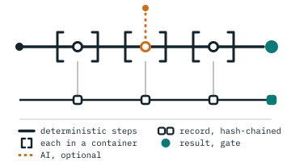

<p></p>

# Traceworks

Repeatable, traceable workflows – deterministic steps, optional AI with any model, tools in containers.

<p></p>

Traceworks is a command line tool that runs workflows. A workflow is a package: a directory of plain files with a
`workflow.json`, its scripts, its rule files and its images. Its steps are deterministic, and a model is asked only
where a step says so. Every step runs in its own container. A run leaves a hash-chained record in plain files that
anyone can check afterwards. There is no database and no service: the tool runs a workflow, writes what happened,
and exits.

It is for work that has to be done the same way again and shown afterwards: checks, audits and reviews of a
repository, with or without a model, where "what ran, with which inputs, and who decided what" needs an answer.

**What it does not do:** it does not make a result right. Traceworks makes the work of a model or a script
checkable: what was asked, what was answered, what was measured and who decided are on record, so a second reader,
a person or another model, can go over what a run found. A workflow that asks the wrong question repeats the wrong
answer, run after run. Whether a result is worth anything is decided by how well the workflow is built for the
question, and by someone who reads what it found.

## The idea

**A package says what is done. The tool gives the frame.** What a check knows lives in the package, so a package
changes without a change of the tool. The frame is the same for every package: Traceworks checks the package, runs
its steps in containers, records what happened, and keeps what an audit knows across its runs in a register.

The format of `workflow.json` is Traceworks' own, and it has one rule: a workflow runs as it is written, or it is
refused. It never silently runs as something else ([docs/workflow-format.md](docs/workflow-format.md)).

How the terms lie inside one another, package, workflow, block, step and container on one side, run, register and
ledger on the other, is one drawing: [docs/architecture.md](docs/architecture.md#the-terms-and-how-they-nest).

Two pages explain it with drawings:

- [docs/features.html](docs/features.html): the key features, each by the same four questions: what goes wrong
  without it, what Traceworks does, where you see it, and what it does not do.
- [docs/audit-loop.html](docs/audit-loop.html): the register, round by round: an audit that knows when it is done.

Both are self-contained pages that load nothing from the network. A repository host shows HTML as source, so open
them in a browser from a checkout.

## Quick start

Nothing is released yet: there is no download, no artifact in a Maven repository and no image in a registry. The
way to get Traceworks is to build it from the sources.

You need Java 21, Maven, git, `bash`, and `docker` or `podman`. The first build downloads the Maven plugins and
Jackson, and the first image build downloads a Debian base image and packages, so both need the network once.

```bash
# The jar: traceworks-cli/target/traceworks.jar. bin/traceworks starts it with java -jar.
mvn -q package -DskipTests

# Once: the image the example's steps run in (the built-in "shell" image).
bin/traceworks images build examples/hello

# Before the run: what the package will do, and what a run would refuse. Both start nothing.
bin/traceworks describe examples/hello
bin/traceworks check examples/hello

# The run. It has four blocks, no AI, and asks one question. With --no-input it does not ask on the
# terminal: it parks at the question and exits with code 5.
bin/traceworks run examples/hello --no-input

# Use the run id that was printed; a prefix of four characters is enough.
bin/traceworks approve <run> --answer Yes
bin/traceworks resume <run> --no-input     # runs the last block, exits 0

# The result.
bin/traceworks show <run>                  # status, the workflow, every step, the gate
bin/traceworks render <run>                # prints the path of run.html: open it in a browser
bin/traceworks verify <run>                # the chain, the blobs, the manifest, the ledger entries: exits 8 if one does not hold
```

Leave out `--no-input` in a terminal and the run asks the question there instead of parking.

The steps see the directory you start the run in as their workspace, read-only, and have no network. The record is
in `~/.traceworks/runs/<yyyy-mm-dd>/<run-id>/`: `events.jsonl`, `blobs/`, `manifest.json` and `run.html`.
`~/.traceworks` is the Traceworks home; `--home` or `TRACEWORKS_HOME` moves it, and `runs_dir` in its
`traceworks.json` moves the runs alone. Change one byte of `events.jsonl` and `verify` exits with code 8.

A block can ask to write the workspace. Its `.git` stays read-only even then, unless you set
`workspace_git_writable` in `traceworks.json`. A block can mount a host folder writable only in or below a folder
you list there in `writable_mounts`. No package can change either setting
([docs/cli.md](docs/cli.md#writable-mounts)).

[examples/hello](examples/hello/README.md) explains the example, and [docs/cli.md](docs/cli.md) every command and
exit code. On a machine where no container runtime works, a run can go to the host with
`--allow-host-execution`; that is a fallback, and a shell command there can do what you can do
([docs/cli.md](docs/cli.md#host-execution)).

## What it gives


Nobody has to take it all at once. A workflow with one AI step ([examples/ai-hello](examples/ai-hello/README.md))
already runs in a container and leaves a record; fixed steps and a register come when a question comes back.

The names are those of [docs/features.html](docs/features.html), where each has its limit written next to it.

| Feature | In one line | Documented in |
|---|---|---|
| Definition independent of the tool | A workflow with its scripts, rules and images is a directory of plain files; the tool reads it and names it by a digest | [docs/cli.md](docs/cli.md#describe), [examples/hello](examples/hello/README.md) |
| Defined once, used again | The same package runs on any workspace, or on a new checkout of a git repository at one commit (`--workspace`, `--source`) | [docs/cli.md](docs/cli.md#isolated-workspace) |
| Repeatable | A run records the package digest, its inputs, every image ID and the setup of every AI call; `traceworks diff` says whether a second run reproduced the first | [docs/cli.md](docs/cli.md#diff) |
| Sealed | `traceworks seal` signs a digest of the package with an SSH key; a sealed package that changed is refused | [docs/cli.md](docs/cli.md#seal-unseal-and-seals) |
| Traceable | The record is an append-only event log in which each line holds the hash of the line before; outputs are blobs named by their SHA-256; a manifest names the last line; a git ledger notes each run when it starts and when it ends, so `traceworks verify` finds a run whose folder was deleted. The ledger is unsigned and stays on this machine | [docs/events.md](docs/events.md#the-ledger) |
| Visible | `describe` shows a workflow before it runs; `run.html` shows the run afterwards, as one static file without scripts | [docs/cli.md](docs/cli.md#describe) |
| Deterministic first, AI optional | A workflow works without any AI: shell steps, tool steps, loops, conditions and questions to a person; no default calls a model | [docs/cli.md](docs/cli.md#ai-steps) |
| The model, chosen per step | A block names its provider and its model, or a choice the workflow declares and an input of the run picks; the record names the model that was asked for and the one that answered | [docs/cli.md](docs/cli.md#model-choices) |
| Contained | One container per step: read-only root file system, no capabilities, resource limits, no network and a read-only workspace unless the block says otherwise | [docs/security.md](docs/security.md#what-the-defaults-protect) |
| Any tool, in a container | A step runs whatever tool an image holds; SARIF output becomes facts that later steps and the register can use | [docs/cli.md](docs/cli.md#tool-mode-of-the-shell-block) |
| Secrets protected | A step gets only the secrets it names; every value is redacted in the record and in what the tool prints | [docs/cli.md](docs/cli.md#secrets), [docs/events.md](docs/events.md#redaction) |
| Controllable | Pause, resume and cancel; approval and input blocks where a person, or an AI actor the workflow names, must decide; gates as `GREEN`, `YELLOW` or `RED` | [docs/cli.md](docs/cli.md#interactive-and-parked-runs) |
| The register | What an audit knows across its runs: findings with an identity, the decisions on them with who made each, reused verdicts, in a hash-chained log; the next run gets it as files | [docs/registers.md](docs/registers.md) |
| Lean | One runnable jar with one runtime library; plain files in one directory; no database, no service | [docs/architecture.md](docs/architecture.md#dependencies) |

## AI steps

AI is optional. `examples/hello` and `examples/audit-hello` call no model, and no setting makes a workflow call one
that its blocks do not name.

- **Two command line tools** do the calls, each in its own built-in image: Claude Code (provider `CLAUDE`) and Pi
  (provider `PI`), which reaches the backend its model names. Any other provider is refused, never replaced.
- **A model server of your own:** a `PI` step can run on a server you declare in `traceworks.json`
  (`local_models`: its URL and a closed list of models). The step names `<backend>/<model>` and needs no provider
  credential. The server must speak OpenAI's chat completions API, and one on this machine is reached by an
  address containers reach, not by `localhost` ([docs/cli.md](docs/cli.md#local-models)).
- **Tools** are set per block: `none` (the default: the model only answers), `read`, `write` or `shell`. Web
  search and fetch are a switch of their own (`web`), off unless a block sets it.
- **Credentials** come from `credentials.json` in the home, written by `traceworks credentials set <NAME>`, or from
  the environment. Claude takes `ANTHROPIC_API_KEY` or `CLAUDE_CODE_OAUTH_TOKEN`; the names Pi takes are in
  [docs/cli.md](docs/cli.md#ai-steps). Without a credential the run is refused before it starts. The credential
  goes to the provider's containers only and is redacted in the record.
- **The network:** the container of an AI step reaches the API of its provider, or your model server, and nothing
  else. Its only way out is an allowlist proxy that Traceworks starts next to it, and the record names every
  connection it asked for, allowed or denied ([docs/cli.md](docs/cli.md#the-network-of-an-ai-step)). Everything a
  model reads is sent to its provider or to that server.
- **The record** keeps the prompt, every tool call and the answer, with tokens and cost.

[examples/ai-hello](examples/ai-hello/README.md) is one AI step with read-only tools. It calls a real model, so it
needs a credential and costs money. What an AI step can still do is in
[docs/security.md](docs/security.md#ai-steps).

### A model's answer in a shell step

Traceworks never writes text a model wrote into shell code. The same holds for untrusted input and for what a
register hands a run. A shell line that names such a placeholder is refused: by `check`, or by the run before
anything runs. The value reaches the command as a named shell variable instead. A block lists its `values`, a
variable name and a template each, and its command reads the variable:

```json
{
  "type": "shell",
  "name": "save",
  "config": {
    "values": {"REVIEW": "{{ block.review.output }}"},
    "command": "printf '%s\\n' \"$REVIEW\" > {{ scratch_dir }}/review.md"
  }
}
```

Bash does not parse what a variable holds. What the command does with the variable is its author's: an unquoted
`$REVIEW` is split, and `eval` evaluates what it is given
([docs/workflow-format.md](docs/workflow-format.md#rules), [docs/security.md](docs/security.md#ai-steps)).

## What a model's verdict is

A deterministic step gives the same result for the same input. A model does not. Three full runs of the mutation
testing audit on the same code gave 8, 14 and 11 findings rated `HIGH`. So a model's verdict is a testimony, not a
measurement, and Traceworks asks of it what one asks of a witness:

- **It is on record.** The prompt and the answer are in the run record, and a change of either shows.
- **It can be checked.** A finding names its evidence, and the register compares it with the facts the run
  measured.
- **Someone answers for the decision.** The model proposes. Who accepts or dismisses a finding in the register,
  and who answers an approval in a run, is the operator's choice, a person or an agent. The record names the actor
  and the time, and the agent when the caller names one (`--agent`, or `TRACEWORKS_AGENT` for a harness). Both
  names are what the caller says: nothing checks them, and nothing signs them.

A loop over a model's verdicts does not end by itself. It ends when the workflow keeps to a few rules. They are
decisions of the workflow's author, and the tool gives the means: a defined workflow, a register as the memory.

1. **A measurement says what there is.** A tool measures the whole set, and the model rates what was measured. It
   adds no finding.
2. **A verdict is given once per state.** What did not change is not judged again.
3. **A verdict changes for a reason:** the thing changed, or a decision was made on it.
4. **Below a floor, nothing goes to the register.** What the model rates `low` is counted in the report of the
   run and is no finding.

Two example audits are built on these rules. Both measure the same: [PIT](https://pitest.org) changes the compiled
code of a Maven project in one place at a time, and a change no test notices is a gap. A model rates each method
with a gap, and the gate counts the findings no person has decided on. They differ in how a rating is given again:

- [examples/mutation-testing](examples/mutation-testing/README.md) rates from zero. Its unit is the Java package: a
  package whose gaps and decisions are what they were at its last rating is not rated, and a changed package is
  rated anew.
- [examples/mutation-testing-grounded](examples/mutation-testing-grounded/README.md) rates again from the earlier
  verdict. Its unit is the method: an unchanged method is not asked about, and the rating of a changed method moves
  only when the answer names a ground, a test or a line of code, that a script finds in the workspace. That shows
  that the place exists, not that the rating is right.

Each has a register of its own.

Two runs that agree show that an audit repeats itself, not that it is right: of the 19 findings the grounded
audit rated `HIGH` on Traceworks itself, in two runs that agreed, 3 held as rated when each was read against the
code ([the numbers](examples/mutation-testing-grounded/README.md#two-real-runs)).

## Audits and the register

An audit is a workflow whose report feeds a register (`metadata.audit`). The register knows a finding of an
earlier run by its rule and its subject, keeps what a person decided on it, and hands the next run what it knows:
as capped placeholders (`{{ audit_findings }}`, `{{ audit_items }}`, `{{ previous_report }}`), and whole as files
in the register folder of the run, `{{ register_dir }}`: `findings.jsonl`, `resolved.jsonl`, `items.jsonl` and
`previous-report.md`. The steps see the folder read-only; an AI step does not see it
([docs/registers.md](docs/registers.md#the-register-folder-of-a-run)).

- [examples/audit-hello](examples/audit-hello/README.md) is the smallest audit with a register: three shell
  steps, no AI.
- [examples/mutation-testing](examples/mutation-testing/README.md) and
  [examples/mutation-testing-grounded](examples/mutation-testing-grounded/README.md) are the two testing audits
  above.
- [examples/self-audit](examples/self-audit/README.md) holds the packages Traceworks checks itself with:
  `security`, `architecture` and `build`. They share one shape: a script measures and chooses, a model judges one
  item per call, and a script checks every quote, counts and sets the gate; `build` asks no model at all. The two
  that ask a model each feed a register, so the next run knows what was found and decided and asks only about what
  changed, was never judged or is still open. Beside `security` stands a short
  check for the time between two full audits,
  [`security-changes`](examples/self-audit/security-changes/README.md), with a register of its own. It judges only
  the code that changed since a commit and the code one call away. It never says GREEN, since it did not look at
  the rest: its best gate is YELLOW.
- [examples/hooks](examples/hooks/README.md): an operator's hook gets the diff of a register that changed.
  `github-issues.sh` opens one GitHub issue per new or reopened finding.

## Status

The version is `0.1.0-SNAPSHOT`. There is no release.

**Built:** the engine and its block types, the check of a package (`check`, `describe`), container runs with
Docker or Podman, the four built-in images (`shell`, `claude`, `pi`, `egress`), the run record and the ledger with
`verify`, `show`, `watch`, `run.html` and `diff`, pause and resume, secrets and their redaction, AI steps with
Claude Code and Pi behind the allowlist proxy, Pi on a model server of the operator's own, model choices, named
values for shell steps, seals, registers with `traceworks findings`, the three self-audit packages, the short
security check beside them and the two testing audits.

**Not built yet:**

- Signatures of the record. A manifest, the ledger, an approval in a run and a decision in a register are not
  signed. The record is tamper-evident, not signed; only a package can be signed, by its seal.
- A server for MCP clients, and MCP servers for AI steps.
- An export of a workflow to BPMN.

**Left out on purpose:**

- A service and a database. The tool runs a workflow, writes plain files and exits.
- A scheduler and triggers. A run starts when a person, a cron entry or a CI job starts it.
- A web page to click in, and dashboards. `traceworks watch` follows a run in the terminal, and `run.html` and a
  register's `report.html` are static files.

**Verified with:**

- Docker 29.1.3. Podman is supported by the code and untested: CI runs the integration tests with it, and that leg
  may fail without failing the workflow.
- Linux. CI runs on Linux only. Where the system has no `setsid` program (macOS), Ctrl-C cancels a run instead of
  pausing it.
- Stand-in command line tools in place of the models, in every automatic test. No test calls a model or uses a
  real credential. The web tools of an AI step are tested this way only, and a model server of the operator's own
  only as a stand-in server that the real Pi command line tool calls.

[docs/security.md](docs/security.md) says what the defaults protect and what they do not. Read it before you run a
package you did not write: a package is code you run.

## Documentation

| File | What it holds |
|---|---|
| [docs/features.html](docs/features.html) | the key features, with drawings (open in a browser) |
| [docs/audit-loop.html](docs/audit-loop.html) | the register and the audit loop, to step through (open in a browser) |
| [docs/cli.md](docs/cli.md) | every command, flag and exit code; the home and `traceworks.json`; AI steps, secrets, images, seals |
| [docs/events.md](docs/events.md) | the run record: the run folder, the hash chain and how to check it by hand, every event type, the manifest, the ledger |
| [docs/registers.md](docs/registers.md) | registers: audit workflows, findings across runs, items, the register folder of a run, decisions, hooks |
| [docs/security.md](docs/security.md) | what the defaults protect and what they do not |
| [docs/architecture.md](docs/architecture.md) | modules, ports and adapters, layers, the life of a run, the dependencies and their reasons, building and testing |
| [docs/workflow-format.md](docs/workflow-format.md) | the workflow format: the key names, and every rule of the format and of a run, each with its reason |
| [examples/](examples) | `hello`, `ai-hello`, `audit-hello`, the two testing audits, `hooks` and the self-audits, each with a README |
| [integration-tests/README.md](integration-tests/README.md) | the black-box suite and what a run of it costs the host |

## Building and testing

Containers start only on purpose. Three commands, from the root of the repository:

| Command | What runs | What it starts |
|---|---|---|
| `mvn verify` | the unit and component tests of every module, and the jar | no container, no image build, no network |
| `mvn -Pcontainers verify` | the same, plus the container tests of `traceworks-adapters` and `traceworks-cli` | real containers through `docker` or `podman`, and two small test images that are removed again |
| `mvn -Pit verify` | everything: the same as `-Pcontainers`, plus the suite of `integration-tests` | the same, plus the containers, images and networks of the suite |

The two profiles need the built-in images, and no test builds them: run
`java -jar traceworks-cli/target/traceworks.jar images build` once after `mvn verify`, and again after a change
below `images/`. With a profile on, a missing runtime or image fails the test that needs it; nothing is skipped.
The details are in [docs/architecture.md](docs/architecture.md#building-and-testing) and
[integration-tests/README.md](integration-tests/README.md); [CONTRIBUTING.md](CONTRIBUTING.md) says how to
contribute, and [SECURITY.md](SECURITY.md) how to report a vulnerability.

## Where it comes from

Traceworks was extracted from a larger private project by the same author and reworked as a tool of its own. The
history before the first commit of this repository is not published.

## License

`SPDX-License-Identifier: GPL-3.0-only`

Copyright 2026 Florian Stampe

Traceworks is free software under the GNU General Public License, version 3 only. The text is in
[LICENSE](LICENSE). The jar includes Jackson, which is licensed under the Apache License 2.0. [NOTICE](NOTICE)
holds the copyright notice, the additional term on the name "Traceworks", and Jackson's own notices.
