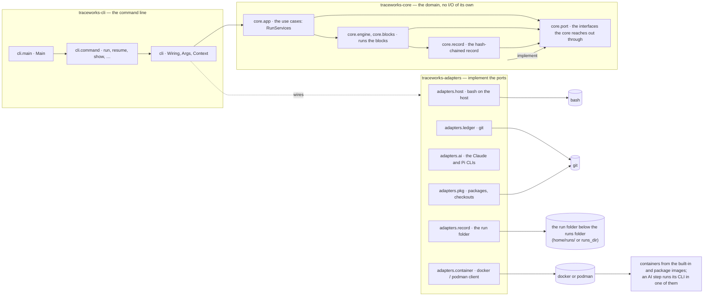
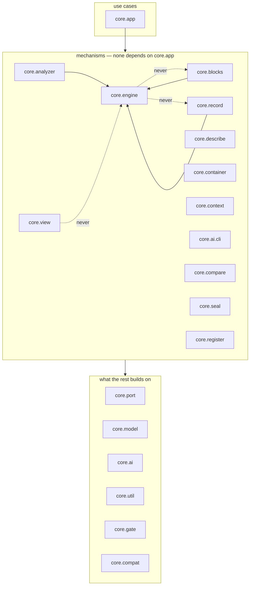
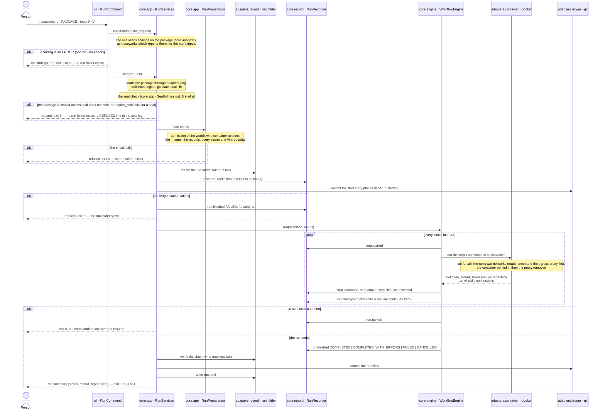
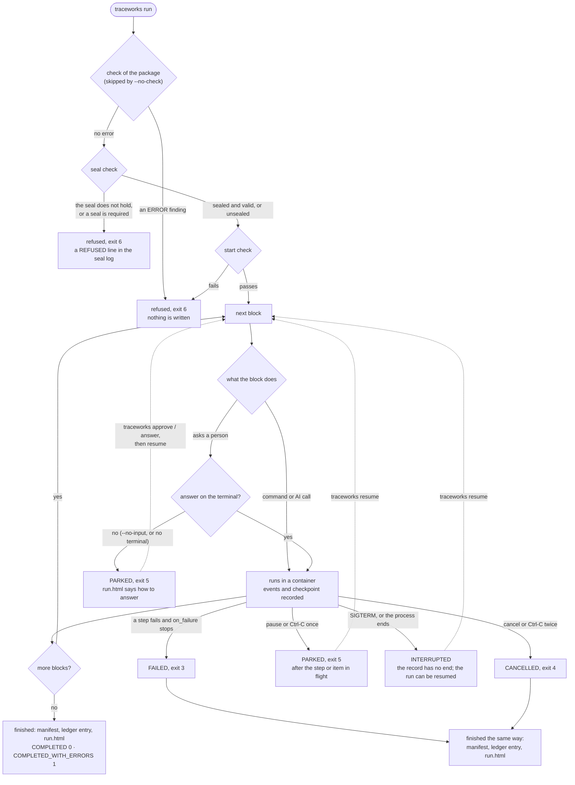

# Architecture

Traceworks runs repeatable, traceable workflows. It is a command line tool, not a service: it runs a workflow,
writes everything that happened to a run folder, and exits.

How a run goes, from the package to the register, in moving drawings: [how-it-works.html](how-it-works.html). The
key features, each explained on one page with drawings: [features.html](features.html). The register, round by
round: [audit-loop.html](audit-loop.html). Open them in a browser; they load nothing from the network.

## Modules

**Ports and adapters.** The core performs almost no I/O of its own. It reaches processes, containers, AI
providers and the run record through interfaces (ports). Adapters implement those interfaces. The CLI wires the
core to the adapters. Maven module boundaries enforce the direction of the dependencies.

A few places in the core still touch the file system or the class path directly, because no port covers them
yet:

- the tool mode of the `shell` block creates its output folder (a temporary directory it removes after the step) and
  the per-image cache folder, and reads the SARIF files the tool wrote;
- `TraceworksVersion` reads the version, and the analyzer's `BlockConfigSchema` the configuration schema of the
  blocks, from resources on the class path.

The first moves behind a port later.

The diagrams on this page are Mermaid; GitHub and most Markdown viewers render them.

Maven enforces the direction: the core depends on nothing of Traceworks, the adapters on the core, the CLI on both.

The core never holds a process. A runner that starts one (the adapters behind `CommandRunner` and
`ContainerRuntime`) reports a stop handle for it to the step's tracker (`core.util.ProcessTracking`), and a cancel of
the run calls the handles; how a process and everything it started end is the adapter's business.

**Ports.** The interfaces in `traceworks.core.port`:

| Port | What the core reaches through it |
|---|---|
| `CommandRunner` | runs one shell command, or a container image's own entrypoint, and waits for it; the adapter decides where (a container runtime, or the host when the operator allows host execution) |
| `ContainerRuntime` | the container runtime (`docker` or `podman`): image IDs, starting one fully specified container, building and pulling images, removing what is left of a run's containers and networks, and whether a container whose removal was not confirmed may still run. For a container that may connect to listed hosts only (`Egress`), it starts the egress proxy as that container's only door and reports the connections it asked for |
| `BuiltInImageSource` | the built-in images the distribution carries (`shell`, `claude`, `pi`, `egress`): each one's name, digest and Dockerfile, and a directory to build it from |
| `HostDirectories` | the real paths of a run's own directories (workspace, package, scratch directory), and the start check of whether a container may mount the workspace and the package |
| `AiProvider`, `AiProviders` | one AI provider (a model behind a CLI or an API) for the AI steps, and the configured providers with the default one; an unknown provider id is refused, never replaced |
| `AiCli` | one AI command line tool as a translator: a call's arguments, environment and stdin, and its outcome (answer, usage, tool calls) from what the CLI wrote; it starts nothing itself |
| `RunEvents` | the engine's events: receives every step, status change and the end of the run, in order |
| `WorkflowResolver` | finds the workflow a `sub-workflow` or `foreach` block names with `workflow_id` |
| `Clock` | the current time, so every timestamp of a run comes from one source |
| `EventLog` | appends hash-chained lines to a run's `events.jsonl` and reads them back; finds and discards a torn last line |
| `BlobStore` | stores content under its SHA-256 and reads it back |
| `Ids` | new run ids and request ids (random UUIDs) |
| `RunStore`, `StoredRun` | finds, lists and creates runs; a stored run gives access to its event log, blobs, inbox, scratch directory, manifest, `run.html` and the writer lock |
| `Inbox` | the requests that other processes drop for a running run |
| `PackageLoader` | reads a package directory: `workflow.json`, the package digest, the git state and the bytes of the seal file when the package carries one |
| `SourceCheckout` | the checkout of a git repository that a run started with `--source` works in: cloned below the home and detached at one commit without running anything of the source, and removed again |
| `Ledger` | notes the start of a run before its first step, commits the manifest of a finished run and finds both again; lists the runs it names with their entries, and keeps the acknowledgement of a run; anchors the head of a register after every write, and lists the anchors |
| `RegisterStore` | the registers of the home (docs/registers.md): one per key, each a hash-chained log, blobs and the derived `state.json` and `report.html`; opened for reading, or for writing under the one lock per register that serialises the writers of every process |
| `HookRunner` | runs an operator's hook: a program on the host, started without a shell, with a payload on its standard input |
| `SealStore` | the seals of the home (docs/cli.md, "seal, unseal and seals"): the hash-chained seal log, opened for reading or for writing under its one lock, the operator's allowed signers file, and the seal file `traceworks.seal` of a package directory |
| `Signer` | signs for the operator: an SSH signature over a message, made with the operator's key by `ssh-keygen`. The core verifies what it returns itself and trusts no signer |

**Packages in the core.** Besides the engine, blocks and analyzer:

| Package | Contents |
|---|---|
| `core.ai` | the provider-neutral AI types the AI port uses: capabilities, usage, the tool policy, tool calls |
| `core.ai.cli` | `CliAiProvider`, which runs an `AiCli` as a container command of the run, through the run's command runner |
| `core.record` | turns engine events into record lines: the recorder (with the recording command runner and AI providers), the hash chain, blobs, the manifest and the chain verifier; reads a record back into a `RunView` |
| `core.view` | renders a `RunView` to `run.html`; pure, no I/O |
| `core.describe` | what a package will do, before any run (`traceworks describe`): reads a loaded package into a `WorkflowDescription` with the rules the run reads a block by, and prints it as text; `core.view` renders it as a page. Pure, no I/O |
| `core.app` | the use cases the command line calls: start, resume, answer, cancel, verify, list, show and compare runs, and build images. They decide where a run runs its steps (a container run, or, where no container runtime works, a host run with the operator's consent) and check before the run exists that it can. They use ports only, so another front end (an MCP server) can reuse them. `RunServices` is their one entry point: starting, resuming, answering and cancelling a run each have a class of their own (`Starting`, `Resuming`, `Answering`, `Cancelling`); what a start and a resume share, the start check and the options the engine runs the run with, sits in `RunPreparation` |
| `core.context` | the state of a run while it runs: the execution context with its variables and their trust (taint tracking of untrusted input), placeholders and templates, the output budget, the approval gate a step parks at, and the registration of the run's process |
| `core.gate` | gate verdicts: parsing the `gate_status` markers a step writes, the synthetic description of a `checked_command`, and whether a workflow expects a verdict at all |
| `core.register` | findings across runs (docs/registers.md, P4): the envelope and `todo_item:` parsers, the identity and reconciliation of findings, evidence verification, dispositions, the register log and its replay; pure, through the ports |
| `core.compare` | compares two finished runs from their views of the record (`traceworks diff`, docs/cli.md): the header, the inputs, the steps and AI calls matched by name, item and order, the rule for "run B reproduced run A", and a bounded line diff in plain Java; pure, no I/O |
| `core.seal` | seals (docs/cli.md, "seal, unseal and seals"): reads and verifies an SSH signature in Java (Ed25519), reads an allowed signers file, reads and writes the seal file of a package, and chains, verifies and folds the seal log of a home; pure, no I/O |
| `core.container` | the container policy of a run: which image a `container_image` names (a registry reference, a package image or the built-in `shell` image), what a command may do as a container (image, mounts, working directory), when the run lists its scratch directory, and `HostSecrets`, the one list of logins below the home that both the analyzer's `secret-mount` rule and the adapter's mount check refuse |

**The model of an AI step.** No new package holds it: `core.engine.ModelChoices` reads a workflow's `model_choices`
and returns the definition as a run runs it, with the picked provider and model in place of every `model_choice`
(docs/cli.md, "Model choices"). It is the one place that takes a pick from the inputs of a run, and it is pure: the
engine calls it before the admission of every run and child run, and the start check in `core.app`
(`RunPreparation`, `WorkflowUses`) calls it with the same inputs, so both judge the same definition.
`core.engine.AllowedModels` is the operator's `allowed_models`, held against that definition in both places.

**Layers in the core.** The ports, the model, the AI types, the utilities, the gates and the earlier and German words (`core.compat`) are
what the rest of the core builds on, and the use cases in `core.app` sit on top. These rules hold, where `core.blocks`
includes `core.blocks.compress`:

| Package | Must not depend on |
|---|---|
| any package of the core | `adapters`, `cli` (and their subpackages) |
| any package of the adapters | `cli` (and its subpackages) |
| `core.port`, `core.model`, `core.ai`, `core.util`, `core.gate`, `core.compat` | `core.app`, `core.engine`, `core.blocks`, `core.analyzer`, `core.record`, `core.view`, `core.context`, `core.container`, `core.ai.cli`, `core.register`, `core.describe`, `core.compare`, `core.seal` |
| any other package of the core | `core.app` |
| `core.view` | `core.engine`, `core.blocks`, `core.analyzer` |
| `core.engine` | `core.blocks`, `core.analyzer`, `core.record`, `core.view` |
| `core.record` | `core.blocks`, `core.analyzer`, `core.view` |
| `core.register` | `core.engine`, `core.blocks`, `core.analyzer`, `core.view` |
| `core.compare` | `core.engine`, `core.blocks`, `core.analyzer`, `core.view`, `core.register` |
| `core.seal` | `core.engine`, `core.blocks`, `core.analyzer`, `core.view`, `core.register`, `core.context`, `core.container` |
| `core.blocks` | `core.analyzer`, `core.record`, `core.view` |
| `core.describe` | `core.blocks`, `core.analyzer`, `core.view` |

The architecture self-audit (`examples/self-audit/architecture`) measures them on the sources, from its
`rules/architecture.rules`, together with the direct I/O of the core outside the places named above.

Solid arrows are the dependencies that are allowed between the layers (a package may use any package of a lower
layer); the dotted ones name the three dependencies inside the middle layer that the rules forbid, so that the engine
knows the executors only through `BlockExecutor` and the record only through `RunEvents`.

The seal check of a run sits in `core.app`, with the other checks before a run (`SealAdmission`, called first by a
start and by a resume): it loads nothing itself, judges the loaded package with `core.seal`, and records a refusal
through the `SealStore` port. The seal digest (`SealClosure`) is there too, because it walks the child workflows
with the resolver a run uses.

**Adapters.** The packages in `traceworks-adapters`:

| Package | Contents |
|---|---|
| `adapters.host` | the host command runner (`bash`, with a reduced environment), `HostHookRunner` (an operator's hook as a process without a shell, with the operator's environment, its stderr tail kept), and `ProcessTree`, which ends a host command or a container client, on its timeout or a cancel, together with everything it started (a git call that times out is ended with `destroyForcibly` alone) |
| `adapters.container` | the container runtime through the `docker` or `podman` client: detection, the fixed secure command line, the check of a step's own mounts and of the run's own directories, timeout, cancel and removal of containers |
| `adapters.images` | the built-in images Traceworks builds, from the jar's resources |
| `adapters.ai` | the AI command line tools: each turns a call into its CLI's arguments, environment and stdin, and reads the CLI's stream into an outcome (Claude, Pi); the system prompt reaches them in a file of the container |
| `adapters.record` | the run folder: event log, blob store, inbox, writer lock (`run.lock`), manifest and `run.html` files; and the register folders under `registers/<key>/` (`FileRegisterStore`: log, blobs, `state.json`, `report.html`, `register.lock`); and the seals of the home (`FileSealStore`: the seal log `seals/events.jsonl` with `seals.lock`, the allowed signers file, and the seal file of a package) |
| `adapters.ledger` | the ledger as a git repository |
| `adapters.pkg` | the package loader, the package digest, the git state of a package, the `images/<name>/` directories of a package (each with the digest of its directory), the checkout of a source, and the one way every git call is started (no fsmonitor, no hooks, no inherited `GIT_*` variable) |
| `adapters.config` | `traceworks.json` in the home, `credentials.json`, and `HomeLayout`: where the home keeps its runs, ledger, registers, checkouts and caches, and the files the seal settings name (`signing_key`, `allowed_signers`), which the mount guard keeps steps from. It is the one place that knows these paths; the command line hands them to the other adapters |
| `adapters.sign` | `SshKeygenSigner`: signs with `ssh-keygen -Y sign` and the operator's SSH key, in a temporary directory of its own, with only what `ssh-keygen` needs of the environment |
| `adapters.system` | the system clock and random ids |

**Command line.** The packages in `traceworks-cli`, from the top down; a package knows only the ones below it:

| Package | Contents |
|---|---|
| `cli.main` | `Main`, the entry point of `traceworks.jar`: it creates every command, parses the arguments, runs the chosen command and turns its failures into exit codes |
| `cli.command` | one class per command (`run`, `resume`, `approve`, `answer`, `cancel`, `runs`, `show`, `watch`, `verify`, `render`, `check`, `describe`, `images`, `diff`, `seal`, `unseal`, `seals`) and what several of them share (`Following`, `Answers`) |
| `cli` | the toolkit the commands use: the `Command` interface, argument parsing (`Args`), the `Context` of a call with the wiring of the core to the adapters (`Wiring`), the exit codes, the terminal output and the console questions |

The architecture self-audit measures this order too (the rules `cli_toolkit` and `cli_main_on_top`).

**Images.** The repository's `images/` directory holds one directory per built-in image, each with a Dockerfile:
`shell` (Debian with bash, coreutils, git, python3, jq and ca-certificates), `claude` and `pi` (Node.js
with one AI CLI at a pinned version) and `egress` (a JDK with the allowlist proxy of an AI step, one Java source in
`images/egress/src` that the image's build compiles), each on a base pinned by digest and with a label
`org.opencontainers.image.description` that says what it holds, which the record of every run keeps (docs/cli.md,
"images"). The build of `traceworks-adapters` copies
`images/` into its jar, and so into `traceworks.jar`, as resources under `traceworks-images/<name>/`, so
`traceworks images build` needs no checkout: it writes an image's files into a temporary directory and builds them
there. A built-in image's tag is
`traceworks/<name>:<h>`, a package image's `traceworks-pkg/<package id>/<name>:<h>`, where `<h>` comes from the
digest of the image's directory (docs/cli.md, "images"). A run never builds or pulls: the start check refuses a run
whose images are missing, and every container starts from the image ID resolved before it.

**The egress proxy** is an image and not a part of `traceworks.jar` because it has to run where the step runs: a
container's network is closed by giving it no route out, and the one process that has a route must sit on the
container's network. So the adapter of the container runtime starts it as a second container next to each AI call,
on the run's two networks, and removes it afterwards. The two networks are made at the run's first AI call and
removed when the run ends in its process (it finished, failed, parked or paused): each is a bridge on the host, and
a run of a hundred calls should not make two hundred of them. The core decides the hosts (`core.port.Egress`,
from the `AiCli` port and the operator's `AiNetwork`) and only names them; the adapter carries it out and hands back
what the proxy printed (`CommandResult.connections`). The proxy uses the JDK only, like everything here: an image
with a ready-made proxy would be a dependency without a written reason, and its log format would not be ours. Its
base is the JDK image the self-audit images already pin.

**Status.** The core, the analyzer, the run record and the command line exist (docs/cli.md, docs/events.md), and
so do the container policy and the container runtime adapter: a run runs its steps in containers by default. The
AI CLI adapters for Claude and Pi exist. Seals are signed and verified; manifests, approvals and register decisions
are not signed yet. docs/security.md says what the container
defaults protect and what they do not.

| Module | Contents | Depends on |
|---|---|---|
| `traceworks-core` | domain model, placeholders and taint tracking, execution engine, block executors, gates, analyzer, ports | Jackson |
| `traceworks-adapters` | implementations of the ports: the host command runner, the container runtime, the AI CLIs, the run folder, the ledger, the package loader, the operator config, the seal store and the signer | core |
| `traceworks-cli` | entry point, argument parsing, wiring and terminal output; builds one runnable jar (`traceworks.jar`) | core, adapters |
| `integration-tests` | the black-box suite: `traceworks.jar` as a process against a real container runtime, with small workflow packages and no AI; it runs only with `mvn -Pit verify` (`integration-tests/README.md`, and "Building and testing" below). Not part of `traceworks.jar` | the jar of `traceworks-cli`; Jackson in test scope |
| `image-tests` | the tests of the tool that the built-in image `egress` compiles, the allowlist proxy; the source stays in the image's directory (`images/egress/src`), so the jar carries it and the image builds it. Not part of `traceworks.jar` | the JDK only |
| `examples/self-audit/tests` | the tests of the tools that the self-audit packages build into their images; the sources stay in the package (`examples/self-audit/security/images/areas/src`). Not part of `traceworks.jar` | the JDK only (`jdk.compiler`) |
| `examples/self-audit/tests-architecture` | the tests of the tool that the architecture self-audit builds into its image; the sources stay in the package (`examples/self-audit/architecture/images/architecture/src`). Not part of `traceworks.jar` | the JDK only (`jdk.compiler`) |
| `examples/self-audit/tests-build` | the tests of the tool that the build self-audit package builds into its image; the sources stay in the package (`examples/self-audit/build/images/facts/src`). Not part of `traceworks.jar` | the JDK only |
| `examples/self-audit/tests-functionality` | the tests of the scripts of the functionality self-audit (`examples/self-audit/functionality/scripts`), run with `python3` on small source trees. Not part of `traceworks.jar` | none (the tests need `python3` on the build machine) |
| `examples/self-audit/tests-testing` | the tests of the scripts of the testing self-audit (`examples/self-audit/testing/scripts`), run with `python3` on small source trees. Not part of `traceworks.jar` | none (the tests need `python3` on the build machine) |

## Building and testing

Containers start only on purpose. Three commands, from the root of the repository:

| Command | What runs | What it starts |
|---|---|---|
| `mvn verify` | the unit and component tests of every module, and the jar | no container, no image build, no network |
| `mvn -Pcontainers verify` | the same, plus the container tests of `traceworks-adapters` and `traceworks-cli` | real containers through `docker` or `podman`, and two small test images that are removed again |
| `mvn -Pit verify` | everything: the same as `-Pcontainers`, plus the suite of `integration-tests` | the same, plus the containers, images and networks of the suite (`integration-tests/README.md`) |

- **The rule is a JUnit tag.** A test class that starts a container, builds or pulls an image, or creates a network
  carries `@Tag("container")`. Surefire leaves that tag out in every module (`traceworks.test.excludedGroups` in the
  root `pom.xml`) unless the profile `containers` or `it` is on. A name pattern would not do: `SecretEndToEndTest`
  starts containers, and `RunServicesContainerTest` of the core runs on a fake runtime. The suite of
  `integration-tests` has its own gate: the whole module is skipped unless `-Pit` is on.
- **It cannot be forgotten.** `ContainerTagGuardTest` (in `traceworks-cli`, part of every build) reads the test sources
  of all modules and fails when a class reaches the runtime of the machine without the tag: `RuntimeDetection.detect`,
  `RuntimeSource.MACHINE`, a `ProcessBuilder` of `docker` or `podman`, the helpers `ContainerTests` and
  `ContainerRuns`, or the command line's `Main.run` without a runtime source. It reads source text, so it knows
  these ways and no others.
- **A container test never skips where it was asked for.** With `-Pcontainers` or `-Pit` a missing runtime, a
  built-in image that is not built, a test base that cannot be pulled and missing cgroup v2 files each fail the
  test, and the failure names the command to run (`ContainerPrecondition`; the guard test refuses an assumption in a
  tagged class). So what a run could not test stands in its list of failures, not in a count of skipped tests.
  Started alone from an IDE, without the profile, such a test is skipped with the same words.
- **Before the first `-Pcontainers` or `-Pit`:** the container tests need the built-in images `shell`, `claude` and
  `pi`, and no test builds them. `mvn verify` builds the jar, then
  `java -jar traceworks-cli/target/traceworks.jar images build` builds the images (it needs the network). They are
  built again after a change below `images/`, which changes their tags.
- **One class:** `mvn -Pcontainers verify -pl traceworks-core,traceworks-adapters,traceworks-cli
  -Dtest=HelloContainerTest -Dsurefire.failIfNoSpecifiedTests=false`. Without the profile the class is left out, and
  Surefire says that no test ran.
- **What a run cost the host:** `scripts/container-footprint.sh mvn -Pit verify` runs the command and then prints
  how many containers, networks and network connections the runtime created meanwhile, and what was left behind
  (`integration-tests/README.md`, "What a run costs the host").
- **The price of the default:** a plain `mvn verify` no longer shows that a step really runs in a container; only
  the two profiles do. CI therefore runs `mvn -Pit verify` on every push, after building the images.

## The life of a run

What happens between `traceworks run <package>` and the summary, and who does it. Every arrow into the record is an
event line of `events.jsonl` (docs/events.md); nothing reaches the record that did not happen, and nothing happens
that does not reach it.

A resume (`traceworks resume <run>`) repeats the seal check and the start check, but not the check of the package (it runs the
definition recorded at the start), takes the writer lock, records `run.resumed` and
continues from the last checkpoint; an answer given while the run is parked is recorded first. A pause (`traceworks
pause`, or the first Ctrl-C) parks the run the same way without a question: the running process records
`run.pause_requested`, finishes the step or the loop item in flight and ends with `run.parked`. A cancel from outside
(`traceworks cancel`) drops a request into the run's inbox, and the running process records `run.cancel_requested`
and ends the step it is in.

What a step sees from inside its container, and what stays outside, is drawn in [docs/security.md](security.md),
"What the defaults protect".

## Dependencies

Every dependency has a written reason. `maven-enforcer-plugin` fails the build on any other dependency in the
compile, runtime, provided or system scope, transitive ones included; only test-scoped dependencies are left out.

| Dependency | Kind | Reason |
|---|---|---|
| Jackson (`jackson-databind`, `jackson-core`, `jackson-annotations`) | runtime | reading and writing JSON (workflow files, events); the JDK has no JSON parser |
| JUnit Jupiter, AssertJ, Mockito | test | unit tests |
| Maven Compiler, Surefire, Jar, Dependency and Enforcer plugins | build | compiling, testing, packaging (including the test helpers shared with the adapters' tests), locating the Mockito agent jar, dependency enforcement |
| Maven Shade plugin | build | puts the command line tool and Jackson into one runnable jar (`traceworks.jar`), so the tool needs no class path |
| Java 21 | external program | runtime |
| `docker` or `podman` | external program | runs every executing step in a container |
| `bash` | external program | runs a step's shell command on the host, only when the operator allows host execution |
| `git` | external program | the run ledger (every call runs with the operator's git configuration switched off), the git state of a package, and workspace checkouts |
| `ssh-keygen` | external program | signing a seal (`traceworks seal`); nothing else calls it. Verifying a signature needs no OpenSSH: the core does it with the JDK |
