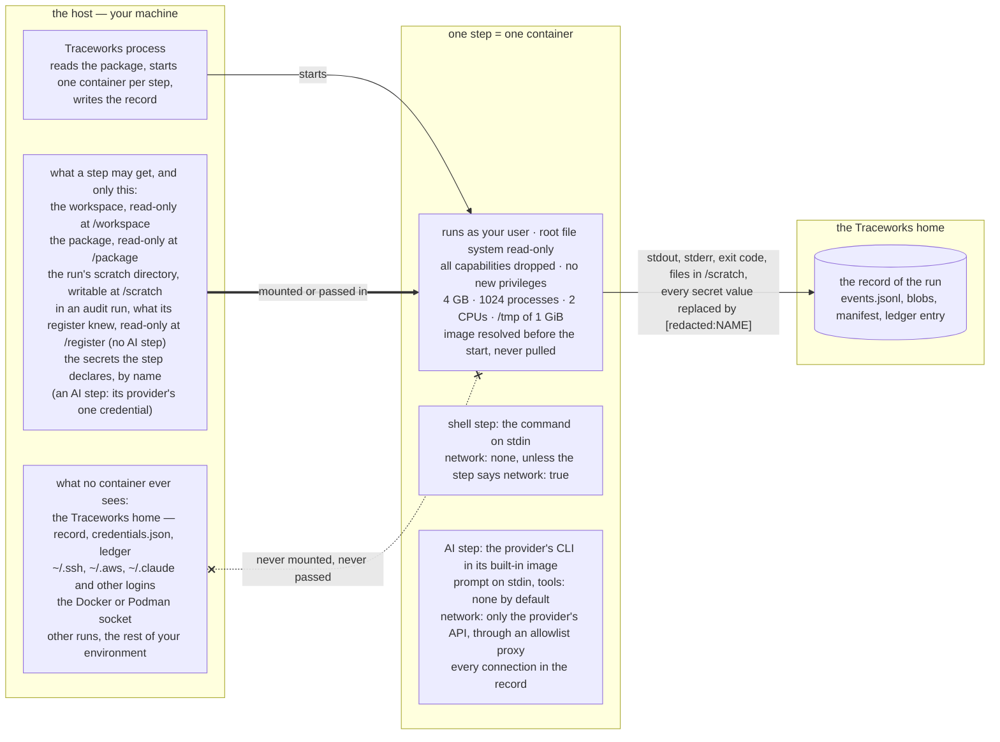

# Security

This page says what Traceworks' defaults protect and what they do not. It assumes that a workflow package, the files
it works on and what a model reads may come from someone you do not trust, and that you, the operator, run Traceworks
on your own machine with your own credentials. The details are in [docs/cli.md](cli.md) and
[docs/events.md](events.md); this page links to them.

## What the defaults protect

The picture first: what a step sees from inside its container, and what stays outside. Traceworks itself runs on the
host, holds the record and the credentials, and hands each container only what its step declared.



A container never sees the Traceworks home, your logins, the container runtime's socket or another run; a step gets
the values of the secrets it names and nothing else of your environment; an AI step gets the one credential of its
provider (a Pi step: of the backend its model names) and no login of the host. Everything a container writes to its output or to `/scratch` reaches the record
with every secret value replaced. The rest of this section says the same in words, with the exceptions.

**Every command runs in a container** (a container run, the default; see "Host execution" in docs/cli.md). Every
container gets the same flags, and no workflow or operator setting removes them:

- a read-only root file system with a writable `/tmp` of 1 GiB, all capabilities dropped, `no-new-privileges`, and
  the uid and gid of the owner of the Traceworks home;
- no network (`--network none`) for a command, unless its shell step sets `network: true`, which needs
  `container.network` in `requires`. An AI call's container must reach its provider's API, and reaches nothing
  else: its only network has no way out but a proxy that connects to the provider's hosts ("AI steps" below);
- memory, process and CPU limits (`container_limits`; by default 4 GB, 1024 processes, 2 CPUs), which bound the
  container; what Traceworks keeps of its output has a limit of its own ("Output" below);
- an image ID resolved before the container starts, and `--pull never`: a run never builds or pulls an image;
- secret values in the client's environment, never on a command line; a step's shell command on stdin;
- an empty, read-only directory over the package's top-level `.git/`, when it has one. The package digest leaves
  that directory out, because git rewrites it without any file of the package changing; so a container does not see
  it either, and a script the digest covers cannot run a payload from there that the digest does not cover. (A host
  run sees the package as it is. An image directory is hashed whole, a `.git/` in it included, because the build
  sends all of it.) Verified with Docker 29.1.3; not verified with Podman. A package with a file name that is not
valid text in the system's encoding is refused: the digest names a file by the text of its path, and two names that
differ only in such bytes would be one.

The Docker and Podman sockets are never mounted. Every container of a run carries the run's label, and `resume`, and
`cancel` of a parked or interrupted run, remove what is left of them before they go on.

**Output.** Traceworks keeps at most the output limit of a command's stdout and of its stderr, each, in a container run
and in a host run alike (docs/cli.md, "Output limit"): 16 MiB, unless the operator sets `output_limit_mib` in
`traceworks.json` (from 1 to 1024 MiB). No workflow can set it, so a package cannot raise its own limit, and every
command of a run has the same one, also an AI CLI's and the image builds. A stream that goes beyond stops the command
at once, the way a timeout does: the process and what it started are ended, and a container is removed. Nothing that
ran the command takes the cut text for the whole one: a shell step fails with exit code 153 and a line that names the
stream and the limit, and so do an inner shell step and a tool step (docs/cli.md, "Tool mode of the shell block"); a `run_if` test, a shell condition and an
`items_command` fail their block, and an AI call fails. The `gate_status:` lines of a cut output set no gate, since a
later one may be lost (a `checked_command` keeps the RED of its exit code). The kept part is the first part up to the limit, cut where no UTF-8 character is
split and before the first characters of a secret value the stream ends with, since the record redacts only whole
values; `step.command.finished` names the stream in `truncated`, and `run.started` and `run.resumed` record the limit
(docs/events.md).

The container runtime keeps no log of a step's output (`--log-driver none`): Traceworks reads the output from the attached
streams, so the daemon holds no second, unredacted copy until the container is removed.

What a whole run holds in memory has a bound as well, its output budget (docs/cli.md, "Output budget"): the input and
output of its finished steps, a running child run's included, what a `foreach`, `while` or `switch` has gathered so
far, the item list of a running `foreach`'s `items_command`, and the values of the variables its steps set, counted as the memory they take (two bytes per character for any
text with a character above U+00FF), at most 128 MiB, or eight times `output_limit_mib` when that is more, unless the
operator sets `run_output_budget_mib` (at least twice the output limit). No workflow can set it. The step whose text
would go beyond fails with a line that names the budget, a loop stops at the item that does not fit, and the run ends
`FAILED` whatever the step's `on_failure` says; a resume that already holds more is refused. So many large outputs, or
a `foreach` over many items, end the run instead of exhausting Traceworks' heap. Measured at the default of 128 MiB, a
run that holds its budget in one loop's output needs a heap of 385 MiB, about three times the budget, whether its text
is plain ASCII or has a `✓` in every item; text spread over many steps needs less (176 MiB for 32 steps of 4 MiB,
either way). That is within the default heap of a machine with 2 GiB of memory.

**Mounts.** A container sees the workspace read-only at `/workspace` unless its block sets `workspace_writable: true`,
the package read-only at `/package`, and the run's scratch directory writable at `/scratch`. In the run of an audit
workflow every container but that of an AI step also sees the run's register folder, read-only at `/register` ("The
register folder of a run", below). Where a writable
workspace holds the package, the container sees the package read-only at its place in `/workspace` too, and a
writable workspace inside the package is refused, so no step changes the package. A block's own `mounts`
must state `:ro` or `:rw`, and each host path is checked on its real path, with `..` and symbolic links resolved: the
home directory, logins below it (`~/.ssh`, the AI CLIs' logins, ...), the runtimes' sockets and storage, your
session's sockets, socket files and folders that directly hold one, the Traceworks home (but for the tool caches of
the tool mode, the run's own scratch directory and its own checkout) with its `runs/`, `ledger/`, `registers/`,
`seals/` and `cache/` also where a link or a setting (`runs_dir`, `ledger_dir`, `registers_dir` in `traceworks.json`) puts them
elsewhere, and a path that does not exist or cannot be resolved are refused. The forbidden
paths are compared with the path as written and with the real path, so `link/..` counts as the folder the kernel
mounts. A block's own mount is resolved once too: the real path the check judged is the path the runtime is given,
and the path as the block wrote it is not read again. Where the package has a top-level `.git/`, a mount of that directory, of something in it, of the package
again or of a folder holding the package is refused too: it would show what the cover hides.
The workspace and the package are checked against the same paths before the run is created, with two differences:
inside the Traceworks home only its `runs/`, `ledger/`, `registers/`, `seals/` and `cache/` are refused (a package or
a run's checkout may lie elsewhere in it), a folder that holds one of the places the settings name is refused wherever
it is, and a folder with a credential store of its own (`.ssh`, `.aws`, ...) is not refused. Each of
them, and the checkout of a `--source`, is resolved once: the real path the check judged is the path the run mounts,
so a directory that something replaces by a link after the check is not what the containers get, and every container
start refuses a run directory that no longer resolves to that path. The full list
is in the row on declared mounts of [docs/workflow-format.md](workflow-format.md).

**Secrets** (docs/cli.md, "Secrets"). A step names the secrets it needs, and only that step gets them, as environment
variables (what it writes is another matter; see "Secrets and the record" below). `credentials.json` is refused
when its group or others can read or change it. A value comes from the environment of Traceworks only for the
names `secret_names` in `traceworks.json` lists, and for none without it: a package you did not write could
otherwise name a variable of your shell and get its value in a container (docs/cli.md, "traceworks.json"). The record replaces every value the run passes on with
`[redacted:<NAME>]`: the event log, the blobs, the checkpoints, `run.html`, the manifest, the ledger and everything
Traceworks prints (docs/events.md, "Redaction"). A scratch file that holds a value is listed without its content or
hash. The fact sheet of a tool step (docs/cli.md, "Tool mode of the shell block") cleans what the tool wrote: a marker
such as `gate_status:` loses its colon, a block boundary such as `<open_todos>` its brackets, a line with a disguised
marker is normalised. That can change a value through the text around it (`status:abcdefgh` after `gate_`), and a
changed value is no exact match. So the values are replaced in every text of the tool (its log, the SARIF messages,
rule ids, tool names and locations, the names of its files) before that text is cleaned, and the cleaning leaves a
`[redacted:<NAME>]` as it is.
A path or a `--source` that holds a value is recorded with the replacement too, and a resume puts the value back
to find the workspace or the package directory. It does that only for the names the run redacts (its declared
secrets and the credentials of its AI providers), and a run whose source, workspace or package directory itself
contains `[redacted:` is refused at the start: a replacement in a record is then always one the redactor wrote. A
resume of a record that holds any other replacement in one of these is refused. A resume never puts a value back
into a source: a value in a path stays on this machine, but a value in the URL of a clone goes to the host the URL
names, and whoever can rewrite the record (a run folder copied from elsewhere) chooses that host. So a missing
checkout whose recorded source holds a replacement is not cloned again, and neither is the missing checkout of a run
folder that is not in the runs folder of this home, whose record was not written here; both resumes are refused and say to
start the run again with `--source` (docs/cli.md, "Isolated workspace").

**AI steps** (docs/cli.md, "AI steps"). Every AI call runs its provider's CLI in the provider's built-in image, unless
the operator replaces it (`ai_images`, see "What they do not protect"), with only that provider's credentials.
**A Pi step sees the credential of one backend.** Pi calls several backends, and a call's container gets only the
credential of the backend its model names: `ANTHROPIC_API_KEY` and `ANTHROPIC_OAUTH_TOKEN` for `anthropic/...`, for a
model without a backend and for a step without a model, `OPENAI_API_KEY` for `openai/...`, `GEMINI_API_KEY` for
`google/...` and `OPENROUTER_API_KEY` for `openrouter/...`. The other keys you stored for Pi never reach that
container. A model whose backend is a model server the operator declared (`local_models`) gets no credential of
any provider: it gets that server's secret, when it has one ("A local model" below). A model that names any other
backend is refused, and the message names the backends Traceworks knows: Traceworks
cannot tell which credential it would take, so it hands over none. A model written as a literal is refused before
the run starts (by `traceworks check`, and by the start check when its backend has no credential); a model built
from a placeholder is refused when its step runs, before its CLI starts.
**Its container reaches only its provider.** What a model may do (`tools`) and where its container can connect are two
switches, and the second is not the workflow's: the container joins one network that has no way out, and next to it
Traceworks starts a proxy (the built-in image `egress`) that tunnels `CONNECT` to the listed hosts and refuses
everything else. The hosts are the provider's API (`api.anthropic.com:443` for Claude; for Pi the API of the model's
backend) and what the operator adds in `ai_hosts`; no workflow can name one. A call to a model server of the
operator's has that server as its only host, and none of these. The proxy reports every request, allowed
or not, and the record keeps them with the call (`egress` in `step.command.finished`: the target and the verdict, never
a path, a header or content); `show` and `run.html` mark a denied one. The proxy and both networks exist only while
the call runs. With `ai_network: "open"` the operator gives the AI containers the runtime's default network instead,
as before this existed (docs/cli.md, "The network of an AI step"). A step may add hosts only for the fetch of a
web page (`web: fetch` with `web_hosts`), which needs `ai.web` in `requires`; see "Web tools" below. Its tools are what the block's `tools` says, `none` by default, and any other level
needs `ai.tools` in `requires`. Claude and Pi start with options that read nothing from the workspace, but for
the exceptions below: no settings, hooks, MCP servers, plugins, skills, `CLAUDE.md` or `AGENTS.md`. A prompt reaches
the CLI on stdin, and no CLI runs a command, skill or template that a prompt names.
Codex is not supported: a workflow that names it is refused.

**Hooks** (docs/cli.md, "findings"). A hook is the operator's own code, configured in `traceworks.json` and never by
a workflow. It runs on the host, without a shell, with the operator's whole environment (a hook that talks to a TODO
tool needs its key; only the variables every child process loses are removed), and gets only the diff of a register:
the findings a report stated, which came from a model and are data. Its output reaches nothing but the register's log
and page: the tail of its standard error, unredacted, so a hook must not print a secret. A hook that runs past its
timeout, or never reads its input, is ended.

**Registers** (docs/registers.md). A register's log is hash-chained and its blobs are verified by name, as a run's,
and its head is anchored in the ledger after every write (a report, the hook's line, a decision), so `findings <key>
verify` finds a changed last line and a cut end. A register written before anchors existed is not anchored until
its next write; `verify` says so. **Lines appended after the last anchor are accepted.** Someone who can write the
register's folder, and nothing else, can append a line that chains (a forged decision); it looks like what a writer
leaves that was cut off before its anchor, so `verify` holds, names the lines as unproven, and the next write takes
them and anchors the head. What shows it: `verify` until then, the note of that next write, and the line
`register.unanchored` it records in the log with the sequence numbers. A register's folder is therefore still worth
the protection of the ledger's. Whoever can write the ledger too can rewrite both, as with a run.

**The register folder of a run** (docs/registers.md, "The register folder of a run"). The run of an audit workflow
gets what its register knew as files, in a folder of the run that every container but that of an AI step mounts
read-only at `/register`. What that means:

- *The files hold more than the placeholders.* Besides every finding with its whole evidence and its description,
  each decision is there with who made it and when (`disposition.actor`, `disposition.at`), which
  `{{ audit_findings }}` does not carry, and the ids of the runs that reported a finding. Every shell and tool step
  of the audit can read that, and what a step prints of it is in the run's record. An audit package you run is
  trusted with the names of the people who decided on its findings.
- *The content is data from earlier runs, and part of it was written by a model*: titles, evidence, descriptions,
  the last report; the notes are a person's. A step that passes text from the folder to a model passes untrusted
  text and should say so (`untrusted_input: true` on that AI step). Traceworks marks the three placeholders as
  platform data and follows them into a shell line or a prompt; it cannot follow a file a step reads. The markers
  in `previous-report.md` are defused, and a line of the `.jsonl` files is ASCII without `<`, so the files as they
  are hold no marker a run or a register evaluates. What a step prints after it decoded a line is its own output.
- *An AI step's container does not get the folder.* A model sees of the register what a step deliberately put into
  its prompt (or the capped placeholders), not everything the register holds. `{{ register_dir }}` in a prompt is
  refused by `check` (`register-dir-in-ai-prompt`) and fails the step at run time, so no model is handed the path
  of a run folder either.
- *No step changes the folder for a later one in a container run*: the mount is read-only, a step's own mount on
  `/register` is refused, and so is one of the run folder, like any mount inside the Traceworks home. That is the
  strong guarantee. *In a host run nothing keeps a command from writing the folder*; the files have no write
  permission, which is a hint. A host run detects instead: it compares the files with the digests in `run.started`
  before every command that gets the folder and starts no such command once they differ; `resume` and `traceworks
  verify` compare them too. The comparison is made before a command, not while it reads: a process an earlier host
  step left running can write in between, and that one command reads it. An AI call gets no folder and is not
  compared.
- *A hash protects against a changed file, not against content that was wrong when it was written.* The digests
  say that the files are what the register gave at the recorded head of its log. Whether a finding in them is
  true, and whether the register's folder was written only by Traceworks, are other questions: the first is the
  triage of the findings, the second the register's chain and its anchor in the ledger (above).

**Host runs** are a fallback for a machine where no container runtime works, and need your consent
(`--allow-host-execution` or `allow_host_execution`), also to resume. The consent never sends a run to the host while
the container runtime answers `version` within 10 seconds; a daemon that answers too slowly, or a socket you may not
use, counts as no runtime (docs/cli.md, "Host execution"). The first line of `run` and the record say where a run
runs. A command on the host gets a reduced environment without your API keys and tokens.

**`--source`** (docs/cli.md, "Isolated workspace"). Nothing of the source runs while it is checked out: no hook, no
filter driver, no submodule, no fsmonitor. A git-lfs file stays its pointer, and line endings stay the commit's bytes.
git's output has the output limit too: a remote that streams messages without end cannot grow Traceworks' memory,
since the call is stopped and the run refused.
Git on the host never runs in a run's checkout after a step ran in it, and a package or a local source inside
`<home>/workspaces/` or inside a runs folder (`<home>/runs/` and the folder `runs_dir` names), where the steps write their scratch
directories, is refused: a clone
of a local source runs `git-upload-pack` in it, which reads its `.git/config`. A `file://` URL is judged on the path
git reads: its part before the path is empty or `localhost`, with or without a user, and holds no `%` and no
bracket, since git decodes the whole URL before it splits the host off and would read such a host as a path. When
Traceworks reads the commit and the state of a package that has its own `.git`, git gets no transport at all: an
empty `GIT_ALLOW_PROTOCOL`, which a `protocol.<name>.allow` of the package's config cannot widen, and no lazy fetch.

**The record** is a hash chain: `traceworks verify` finds a changed or removed line, lines copied from another run, a
changed blob, and a manifest or ledger entry that does not match the log.

**A run that began is named outside its folder.** The ledger gets an entry when a run starts, before its first step,
and no step runs without it, at a start and at a resume (docs/events.md, "The start entry"). What that gives, in
three groups:

- **What the check finds on this machine** (`traceworks verify` without a run, exit 8): a run that started, never
  ended, and whose folder is gone, empty or holds another record; an entry that is not what the commit that names
  it left, by the SHA-256 in that commit's message, because a later, ordinary commit changed or removed it (so a
  rewritten record with a new manifest committed over the end entry is found, also by `verify <run>`); anything in
  the ledger that is no regular file at the path of an entry, and a path a tree lists twice; a
  commit that names a run without its entry; an end entry added by hand that is no manifest of the run or does not
  agree with its commit and its start entry, and a manifest in the run folder that is not the end entry; a run
  folder whose record says its start was noted and that has no start entry (a ledger deleted and made again,
  another `ledger_dir`, a kill between `run.started` and the commit), unless its process is alive and that line
  is younger than five minutes; and a ledger
  with replace refs, a shallow or grafts file, alternates, a `.git` that is not a plain directory, a second
  branch, a merge, a detached HEAD, a commit HEAD does not reach, or a setting of its own that is not allowed
  there (docs/events.md, "The ledger's own git settings"; the same rule refuses a run before it starts). An honest
  cause is acknowledged with a note, which the ledger keeps and the check lists for good; it covers what the check
  said then and nothing that comes later.
- **What a ledger that others hold adds:** a rewritten history that no reference names any more is not found on
  this machine. The ledger is a plain git repository, so the operator can push it to a remote they do not control
  alone and that refuses a rewritten history (a protected branch without force push, or an append-only mirror).
  What was pushed can then be changed only by an ordinary commit on top, which the remote takes and the check
  finds; the remote itself finds nothing, it keeps the commit from being taken out again. Traceworks does not push
  by itself, has no setting for a remote and writes the ledger without git hooks, so the push is the operator's: a
  cron entry, a timer or CI that runs `git push` in the ledger folder. Entries that are not pushed yet are only as
  safe as the machine, so the time between two pushes is the time in which a run can still be hidden.
- **What nothing in this version finds:** what was done to an entry of an earlier version before this version
  pinned it (docs/events.md, "Entries from before the hash"); a forged entry made with write access to the ledger (the ledger is not
  signed: a well-formed end entry or an acknowledgement can be committed by hand, and the run then reads as ended
  or acknowledged); a record cut to its first line (it reads as a crash right after the start, and stays listed as
  started and not ended); and an audit run somewhere this ledger does not see at all (another home, another
  `ledger_dir`, the ledger folder swapped for the time of the run, a jar of a version that noted no start). Against the last, start audits only from a place that owns
  the home, such as a CI job with its own account that pushes the ledger after every run, and accept as a result
  only a run whose start entry is in the pushed ledger.

`run.html` has no scripts and loads
nothing, and the terminal shows text from a run with its control characters made harmless. A run folder opened by
its path may come from anyone, so its `blobs` folder counts only as a real directory and a blob only as a regular
file: nothing is read through a symbolic link at either, which would show a file from outside the folder as the run's
content, and no blob is written through one.

## What they do not protect

### AI steps

- **Who chooses the model of an AI step.** The workflow does: a step names its provider and model, and nothing at
  the start of a run changes a named model. A workflow may open the choice to whoever starts the run, among options
  it declares (`model_choices`; docs/cli.md, "Model choices"): the caller picks one by its name, and a value outside
  the list refuses the run. So a caller can move a run to another declared model, with other strengths, costs and a
  provider that then sees the prompts, but never to a model the package does not list. The pick is read once, from
  the inputs the run starts with: no step output, workspace file or variable a step sets can change it, in the run or
  in a child workflow. The operator can narrow what runs in a home with `allowed_models` in `traceworks.json`, for
  named and for picked models alike, and cannot widen a package's list with it. What this does not give you: without
  `allowed_models`, any package may name any model of a provider you hold a credential for; and a step that names no
  model runs its provider's default, which Traceworks does not know. `run.started` names the pick, and every
  `ai.request` the provider and model of its call.
- **A local model** (docs/cli.md, "Local models"). The operator declares a model server of their own in
  `local_models`, and a `PI` step whose model names it runs against that server. What that changes, and what it
  does not:
  - *Nothing of the step goes to a provider.* The call gets no credential of a provider, and its container's only
    host is the server: the hosts of Anthropic, OpenAI, Google and OpenRouter are not on its list, and neither are
    the operator's `ai_hosts`. An attempt to reach one is refused by the proxy and is in the record as a `DENY`.
    This holds with `ai_network: "open"` too: a local step always runs behind the proxy. With a server on your own
    machine or network, the prompt, the files a model's tools read and the answer stay there.
  - *Only the operator names a server.* `local_models` is read from `traceworks.json` only. A workflow asks for a
    server by its id and for one of the models the operator listed; it cannot name a URL, add a model or change
    the key. Pi's provider configuration is written by Traceworks from the setting alone, reaches the container
    in an environment variable and never comes from the workspace; no extension is loaded for it, and Pi starts
    with the same options as for a provider.
  - *What Traceworks cannot know: what the server does with what it gets.* A server that is a gateway, a hosted
    service or a proxy in front of a provider forwards the prompts, and Traceworks sees only the `host:port` you
    named. "Local" is what you declared, not what Traceworks verified. The record says which server a call went
    to (`local` in `ai.request`), not where that server sent it.
  - *A small local model is a weaker model.* Its answers are less reliable than a large provider model's, and it
    follows instructions hidden in what it reads more easily. Keep `tools` low and the workspace read-only on such
    a step, check its work in a deterministic step, and do not let its verdict alone set a gate.
  - *Plain HTTP is not encrypted.* A server whose `url` starts with `http://` gets the prompt and its key in clear
    over the network between this machine and the server. The proxy forwards plain HTTP to exactly these servers
    and to no other target. Use it on a network you trust, or give the server TLS.
  - *The server's key.* The `secret` of a server is a secret like any other in `credentials.json`: the record
    redacts it, a model with tools can read it in its container (below), and a step of any package may declare
    the same name in `secrets` and get the value. Give a local server a key that is worth nothing elsewhere.
  - *A server on this machine is a service of this machine.* It must listen on an address the proxy's container
    reaches. Bind it to one such address, or put a firewall rule in front of it: a server that listens on every
    address (`0.0.0.0`) is reachable from your whole network. Whether a step's container reaches it only through
    the proxy depends on the runtime: with Docker 28 or newer the machine has no address on the step's network,
    so the proxy and the one `host:port` of the URL are the only way. With an older Docker and with Podman the
    machine keeps an address there ("The host's own services, on an older runtime" below), and a server that
    listens on it is reachable directly from the container of every AI step, a provider's steps included, past
    the proxy and without an `egress` line. Traceworks does not warn about this when a run starts.
  - *The refusal of `localhost` is a hint, not a barrier.* `localhost`, `127.0.0.1` and `0.0.0.0` are refused as a
    `url` because they cannot work from a container; any other name or address is taken as the operator wrote it.
  - *One server, several names.* The proxy allows a `host:port`. For a forwarded plain HTTP request it sets the
    `Host` header to that `host:port`, so a server that serves several names there is asked for the listed one
    only. Inside a tunnel (`https://`, or a client that tunnels plain HTTP) the proxy sees no header: a reverse
    proxy that serves other names on the same `host:port` can be asked for them. List a server, not a gateway to
    several.
  - *A child workflow the start check did not see.* A child named through a placeholder is judged at its step,
    not at the start. Its call to a declared server without a `secret` runs; what still holds there is the
    server's closed list of models, `allowed_models`, and the server as the container's only host.
  - *Not verified* (Pi 1.5.2 was read, not run, to build this; no model was called): whether Pi sends the key as
    `Authorization: Bearer` with `authHeader: true`, as its reference says, which Traceworks writes for a server
    with a `secret`; whether Pi asks the server for anything besides the
    chat completion (a list of models, for example); whether Pi sends a plain HTTP request through its proxy as a
    tunnel or as a forwarded request (the proxy takes both); and what Pi makes of a model name with a `:` in it.
    The container test `AiLocalModelIT` shows the first three in its record. Podman is not verified at all.
- **`ai_images` replaces the built-in image.** The guarantee that AI runs only in the built-in images holds only while
  the operator replaces none (docs/cli.md, "AI images"). A replacement image gets the provider's credentials, the
  workspace (read-only unless the step writes it), the prompt and the network exactly as the built-in image would, and
  Traceworks never builds, pulls or inspects it: whatever its entrypoint and contents do, they do with all of that.
  Only the operator can set it: a package has no key for it, and an environment variable does not set it. `run.started`
  and `run.resumed` record the replacements in force, and each AI call's command names the image and its ID.
- **An AI container reaches its provider, and everything a model reads goes there.** The allowlist limits where a
  container can connect, not what the model sends to the host it may reach: the prompt, the files its tools read and
  their output all go to the provider. `ai.tools` in `requires` is the declaration for what a model may read.
- **What the allowlist closes, and what it leaves.** It closes the open network: a model with `shell` tools can no
  longer send what it finds, its own credential included, to a host of its choosing; the attempt is refused and is in
  the record as a `DENY`. What is left:
  - *The provider's own host.* It is reachable, so a model with `shell` tools can talk to the provider's API itself,
    with any key: it could hand what it read, or the run's credential, to another account of the same provider. The
    proxy sees only `host:port`, never which account a connection serves.
  - *The hosts in `ai_hosts`.* Each is a way out for every AI container of that CLI. A gateway or a mirror that
    forwards requests widens the allowlist to whatever it reaches.
  - *`ai_network: "open"`.* Then nothing of this holds, and no connection is recorded; `run.started` says so, and
    `run` and `resume` print a note.
  - *The host's own services, on an older runtime.* With Docker 28 or newer the host has no address on the step's
    network (verified with 29.1.3: a service of the host that listens on every address is not reachable). An older
    Docker and Podman do not know that option: there a container may reach what the host itself serves on that
    address. Not verified on either.
  - *Names.* On Docker's internal network a container resolves only the proxy's name, and no outside name
    (verified with 29.1.3 only), so a DNS query carries nothing out. Whether Podman's internal network forwards
    DNS is not verified.
  - *A denied connection is an observation.* It fails no step and changes no gate; look at the run.
  - *The proxy is no TLS inspector.* It tunnels bytes to a listed `host:port` and cannot tell what is inside.
  - *Podman is not verified at all* for this: the code gives it both networks as one list, and nothing more is known.
- **Web tools** (`web`, docs/cli.md "Web tools of an AI step"). They are off unless a block sets them and the
  workflow declares `ai.web`. What they open:
  - *Prompt injection from what the model reads.* A page or a search hit is foreign content and can carry
    instructions aimed at the model. A step with web always runs as with `untrusted_input: true`: the model is told to
    treat such content as data, and the step's input and output are searched for the common phrasings, which turns
    the gate yellow. That is a tripwire, not a filter. What limits the damage is what the step may do: keep `tools`
    low on a step with web, and the workspace read-only.
  - *Exfiltration through a fetch.* With `web: fetch` the model chooses the URL, and a URL carries data: a path or a
    query string to any host in `web_hosts` hands that host whatever the model put there, a secret it read
    included. The proxy sees and records only `host:port`, never the URL; the URL is in the record as the
    argument of the tool call (`ai.tool_call`), with secret values redacted. List only hosts you would send the
    step's data to. With `["*"]` that is any public host: every connection is recorded, none is refused for where
    it goes.
  - *Exfiltration through a search.* A search query goes to the provider, which runs the search; the query can carry
    what the model read. It is recorded as the tool call's argument, and no allowlist applies to it, since the
    container connects to the provider only.
  - *What `["*"]` still refuses.* For a target only the star allows, the proxy refuses every port but 443, every
    IP address, and every name that resolves to an address of the machine or its network (loopback, private,
    link-local, 100.64/10, multicast, and their IPv6 forms); it resolves once and connects to the address it
    checked. So a page cannot send the model to a service of the host, the local network or a cloud metadata
    address. It does not judge public hosts. A host listed by name gets no such check: you named it.
  - *`ai_network: "open"`.* Web tools still work; `web_hosts` is recorded and not enforced, and no connection is
    recorded. The views say so.
  - *Not verified* (no model was called to build this): whether Claude's `WebFetch` connects from the container to
    the page's host only, or also needs another host (a domain check at the provider, for example). If it does, the
    record shows a `DENY` for that host, and the operator can add it in `ai_hosts.claude`. Whether `WebSearch` is
    enabled for an account is the provider's matter. That the tools are offered to the model is verified: Claude
    Code 2.1.288 lists exactly the named tools at its start.
  - *Pi has no web tool,* so there is nothing of this on Pi; a step that asks for it is refused.
- **A model with tools can read its own credential.** Measured with a dummy key against a fake API on the
  container's loopback:
  - Claude: a command of its `Bash` tool (`tools: shell`) shows the key in `env`, and `/proc/<pid>/environ` of the
    `claude` process and of the container's init (`/proc/1/environ`) is readable and holds it. With `tools: read`,
    its `Grep` tool finds the key in `/proc/1/environ`; its `Read` tool refuses that file.
  - Pi: the same for its `bash` tool; with `tools: read`, its `read` and `grep` tools return `/proc/1/environ` with
    the key.

  The record redacts the key, but the model can put it into its answer, which later steps of the run see as it is.
  With shell tools it can no longer send it anywhere: its container reaches the provider's hosts only (above). It can
  still send it there, under another account. Give AI steps a key you can limit and revoke, and keep `tools: none`
  for steps whose prompt carries content you do not trust.
- **A model's answer in a shell command.** Traceworks never writes a protected value into shell code. Protected
  is text a model wrote, untrusted input, platform data (`previous_report`, `audit_findings`, `audit_items`,
  `previous_chain_output`) and every output of a run that carries untrusted input. A shell line that names such a
  placeholder is refused, wherever it stands, quoted or not, with or without `shell_escape_variables`: `check`
  reports it as an error (`protected-value-in-shell`) where the workflow shows it, and the run refuses the line
  before anything runs otherwise. The way in is by name: a block lists `values`, a variable name and a template
  each, and its shell lines find the variables set (`"$REVIEW"`). Traceworks reads no shell text to decide where a
  value would be harmless; no reading of shell text is bash's.
  - **How a value arrives.** The text bash parses holds the lines Traceworks writes first, alone and without any
    text of the workflow, then the command as its author wrote it. The value travels encoded, in letters, digits
    and `\xHH` inside single quotes, an alphabet that means nothing to bash's parser, and bash itself decodes it
    into the variable (`printf %b`): what a variable holds, bash does not parse.

    ```
    case "${BASH_VERSINFO[0]:-0}.${BASH_VERSINFO[1]:-0}" in [012].*|3.0) echo "traceworks:3f0c9a…: this bash is older than 3.1, which a step with values needs" >&2; exit 74;; esac
    TRACEWORKS_VALUE() { local LC_ALL=C TRACEWORKS_V TRACEWORKS_A; printf -v TRACEWORKS_V '%b' "$3" && [[ ${#TRACEWORKS_V} -eq $2 ]] && unset -v "$1" && printf -v "$1" '%s' "$TRACEWORKS_V" && export -n "$1" && [[ ${!1} == "$TRACEWORKS_V" ]] && { trap '' PIPE; declare -p "$1" 2>/dev/null; :; } | { IFS= read -r -n $((12 + ${#1})) TRACEWORKS_A; [[ $TRACEWORKS_A == "declare -- $1=" ]]; } || { echo "traceworks:3f0c9a…: the value of $1 was not delivered" >&2; exit 74; }; }
    TRACEWORKS_VALUE REVIEW 17 'it\x27s\x20\x24\x28not\x20run\x29'
    unset -f TRACEWORKS_VALUE
    printf '%s\n' "$REVIEW" > review.md
    ```

    Every byte arrives, trailing newlines included, for a value as large as the output limit (16 MiB takes bash
    some seconds, and up to four times its size in the text). A NUL is taken out before the value is sent: no shell
    variable holds one. A tool step (`container_args`) runs no shell and takes no values.
  - **Delivered or nothing runs.** What bash decoded is compared with the length that was sent, and after the
    assignment the variable itself is compared with what was decoded. A variable that does not hold the value (a
    readonly one, one bash sets itself) ends the shell with exit code 74 before the command's first line. The line
    it writes then holds a token, the digest of the lines that carry the values; a value cannot write it, since it
    would have to hold the digest of a text that holds the value. So the engine tells a failed delivery from a
    command that ends with 74 by itself: the command counts as not run, a `run_if`, a shell `condition` and the
    condition of a `while` fail their block on it, and none of them reads it as "false".
  - **Not exported, unless the command exports it.** A value is the shell's own variable. The name is unset before
    the assignment, which takes it out of the environment the step started with, the export attribute is taken off
    after it, and a variable that still has any attribute fails the delivery (`declare -p`, read through a plain pipe, must
    begin with `declare -- NAME=`); so no process the command starts
    inherits the value. The author exports it knowingly with `export NAME`. A name that a program reads as its
    configuration (`GIT_*`, `*_OPTIONS`, `LD_*`, `PYTHON*`, `NODE_*`, `JAVA_*`) then hands a model's text to that
    program, which may run what it says: `check` warns about such a name (`value-name-configures-program`). A name
    bash itself sets or uses is refused (`invalid-value-name`): every variable of the sections "Bourne Shell
    Variables" and "Bash Variables" of the bash manual, `_`, and the names that start with `BASH`.
  - **What is model text.** From the first call of a model on (a `simple` or `agentic` step, a wrapper in AI mode,
    `compress-ai`, a step an AI actor decides, a child workflow that asks one), every step output recorded since
    and every variable made from one: `{{ block.<name>.output }}`, `{{ previous_output }}`, `{{ step_N_output }}`,
    a `foreach` item from an `items_command`, an AI actor's answer to a `human-input`, an approval's `auto_answer`
    filled in from a placeholder. It covers the outputs of the shell steps after the call too, because such a step
    can print what the model wrote, or a file the model wrote, without naming a placeholder. It holds in a child
    workflow the values are handed to, for the output of a child (or a child of a child) that asked a model, and
    after a resume. What a step recorded before the first call is inserted as before, and a run that asks no model
    and carries no untrusted input runs as it always did. A trusted write takes the mark off a variable again: the
    static `items` of a `foreach`, a person's answer.
  - **Which bash.** A step with `values` needs bash 3.1 or later, on the host and in the step's image: `printf -v`,
    which sets the variables, came with 3.1. The first line checks the version in syntax every bash reads and ends
    an older one as a failed delivery. The lines after it use nothing a bash from 3.1 on reads differently, so a
    part that does not work in some bash fails the delivery and never skips a check; they use no syntax that depends on the shell's mode, so they read the same in POSIX mode.
    Run and tested with bash 5.2, also as `bash --posix`;
    the built-in images have that.
  - **An output is protected when a value that went into its block was.** Every template a block fills in, for
    any purpose (a prompt, a question, a default value, an automatic answer, `values`, a `context` entry, a switch
    expression), notes the mark of each placeholder, and the output the block records takes the strongest of them
    together with the state of the run: `{{ block.<name>.output }}`, `{{ previous_output }}` and
    `{{ step_N_output }}` alike. Untrusted input and platform data make the output tainted, and with it the run
    from there on; model text a parent handed over makes the run one that holds model text. A child workflow hands
    back whether it asked a model and whether it ended tainted, so its output is protected in the parent, through
    any number of levels.
  - **A value built from a protected one is protected.** A variable a block fills in from a template is protected
    when any placeholder that went into it is, whatever the state of the run: an entry of a `foreach`'s `context`,
    the `default_value` of a `human-input` taken after a timeout, an approval's `auto_answer`. Built from platform
    data it is platform data, in a child workflow it is handed to as well (`__platform_keys`); built from untrusted
    input or from model text it is that.
  - **What the author's command does with the variable is the author's.** Traceworks guarantees that the value is
    in the variable and nowhere in the code. Two classic traps remain. An unquoted `$REVIEW` is split into words
    and its `*` matched against file names: write `"$REVIEW"`. And a command that evaluates what it is given runs
    the value: `eval "$REVIEW"`, `bash -c "$REVIEW"`, `$REVIEW` as the command itself, and bash's arithmetic, which
    evaluates a variable's content (`$(( REVIEW ))`, `[[ $REVIEW -eq 1 ]]`, an array index, `declare -i`). The
    same holds for programs that take code: `xargs`, `find -exec`, `ssh host "$REVIEW"`, an `awk` or `sed` program.
  - **No protected value outside a shell line either.** A tool step's `container_args`, the host path of a
    `mounts` entry and a child's `workflow_id` take none, model text included: it would choose what the tool does,
    what the container sees or which workflow runs. The image of a step (`container_image`), its `network` and its
    secrets are read as written, without placeholders; a hook gets its payload on standard input and its program
    and arguments from `traceworks.json`; the git commands of `run --source` take the operator's arguments only.
  - **Earlier checkpoints.** A checkpoint written before model text was kept says nothing of the calls before it,
    so it is read closed: a run resumed from one counts as a run that asked a model, and every output and every
    variable the checkpoint holds is protected (the run's own variables, such as `project_path` and `scratch_dir`,
    are set anew and trusted). A step after the resume whose shell line names one of them is refused; hand the
    value over under `values`, or start the run again. A checkpoint written now has a format number such a version
    refuses.
- **A gate from an AI step.** A `simple` or `agentic` step can set the run's gate with a `gate_status:` line, since a
  report step delivers its verdict that way; a model steered by what it reads can therefore set a gate too. Keep the
  verdict in a step that checks the model's work, as `examples/self-audit/security` does. The output of a wrapper in
  AI mode (`foreach`, `retry`, `while`, `conditional`) sets no gate, and a marker counts only at the start of a line
  after a line feed, not after U+2028, U+2029, U+0085 or a lone carriage return.
- **Claude as root.** Containers run as the owner of the Traceworks home. When that is root, Claude refuses every tool
  level above `none`, so such a step fails; Traceworks does not override the refusal. Run Traceworks as a normal user.
- **A prompt that starts with `/`.** Claude reads a leading `/compact`, `/init` or another of its own command names as
  that command, does not run it, and answers that it "isn't available in this environment". That reply is the step's
  answer and is in the record. Do not start a prompt with `/`.
- **Pi as root.** Pi runs as root with every tool its step allows, its `bash` tool under `tools: shell`. Run
  Traceworks as a normal user.
- **Pi with a Claude subscription token** (`ANTHROPIC_OAUTH_TOKEN`, or an `sk-ant-oat...` value in
  `ANTHROPIC_API_KEY`) presents itself to Anthropic as Claude Code: its user agent and beta headers say so, and an
  identity line comes first in its system prompt. That is Pi's own behaviour. Use an API key if you do not want it.
- **Pi and a writable workspace.** With `workspace_writable: true`, Pi still applies nothing of the workspace's
  `.pi/` (`--no-approve`, measured with Pi 1.5.2 under a home that trusts every project), but it renames a
  `.pi/commands/` folder there to `.pi/prompts/` when it starts. A step before it can have written that folder.
- **Codex is not supported.** Traceworks refuses a workflow that names it as a provider
  (`unsupported-provider`), and a run that reaches such a workflow by a literal `workflow_id` before it starts. Codex
  cannot restrict its tools, so it would run with every tool and no sandbox of its own, and its isolation from the
  workspace rested on how one version was observed to behave. Traceworks runs only Claude and Pi, which restrict their
  tools.

### Secrets and the record

- **Redaction is exact-match only.** A value is found byte for byte. A step or a model that writes it encoded (base64,
  split, escaped, reversed) puts it into the record readably. Redaction keeps accidents out of the record; it does
  not stop a step that means to leak. Declare a secret only on the step that needs it.
- **A step can do anything with its secret.** It is an environment variable of its command; with `network: true` the
  command can send it anywhere.
- **The scratch directory keeps what steps wrote, in plain text.** `<run folder>/scratch/` is not part of the record:
  a file there that holds a secret is listed without its content, but the file stays. Treat a run folder that has a
  scratch directory as sensitive, and delete the scratch directory when you no longer need it (`verify` does not read
  it).
- **The inbox keeps what you sent a running run, in plain text.** An answer, a field's value or a comment that
  `traceworks approve` or `traceworks answer` gives a run that is still running reaches it through
  `<run folder>/inbox/`, and the request stays in `inbox/done/` as you typed it after the run has taken it. The record
  redacts it; `inbox/done/` is not part of the record and is not redacted. Treat it like the scratch directory, and
  never type a secret into an answer.
- **Later steps read what a step wrote.** A value a step writes into `/scratch`, or into a writable workspace, is
  there for every later container of the run (and, in a host run, every command on the host), AI containers
  included: they reach their provider, and with tools above `none` their read tools reach `/scratch` and `/workspace`. Write
  a secret nowhere a later step can read it, or remove it before the step ends.
- **An answer to a parked run is redacted like the rest of the record.** What you give a parked run with
  `traceworks approve` or `traceworks answer` (the answer, a field's value, a comment) is recorded with the secrets the
  run's definition declares and the credentials of its AI providers redacted, with the values `credentials.json` and the
  environment hold at that moment, as a resume redacts. A value that is in neither is not known and not redacted, and
  a secret you typed that is not one of the run's is recorded as typed, so still never type one into an answer. If the
  run's package cannot be loaded, the answer is refused with the reason the resume would give.
- **A resume redacts with the values it has at the resume.** A resume, and an answer to a parked run, read the
  values of the run's secrets and credentials again, from `credentials.json` and the environment as they are then.
  When a value changed while the run was parked or interrupted (a rotated key, a short-lived token), the resumed run
  knows only the new one: an old value that a later step prints, for example from a file an earlier step wrote into
  `/scratch` or the workspace, is recorded in clear. The record keeps nothing derived from a value (a hash of a
  short value can be guessed), so a resume cannot tell that a value changed. It can only warn: when
  `credentials.json` was modified after the run stopped (its `run.parked` line, or its last line for an interrupted
  run) and holds a secret the run declares or a credential of an AI provider it uses, `traceworks resume` prints a
  warning on standard error that names the file and those names, never a value, and then goes on as before; the
  warning is not recorded. It compares only the file's modification time, so it cannot see a value that came from an
  environment variable (which has no such time), a value changed and changed back, or a file whose time was set
  back; a file saved without a change warns all the same. An answer to a parked run gives no such warning: it does
  not resume the run, and the resume after it warns. Resume with the values the run was parked with, or let no step
  after the park print what an earlier step stored.
- **The runtime shows a container's environment.** While a container runs, `docker inspect` shows its environment,
  secret values included, to anyone who may use the runtime, and the `docker` or `podman` client process holds them
  in its own environment. Keep the runtime to yourself.
- **The record is tamper-evident, not signed.** Manifests carry no signature in this version; only the seal of a
  package is signed ("Seals" below). Whoever can write the
  Traceworks home can rewrite a run folder and its ledger entries together, the start entry too. Keep a copy of the
  ledger (a git repository) where your runs cannot write: push it to a remote that refuses a rewritten history
  ("A run that began is named outside its folder" above). Traceworks does not push it. `ledger_dir` puts the ledger itself on another disk; that changes where it lies, not
  who can write it: Traceworks writes it as the user who runs it.
- **The places are the operator's.** `runs_dir`, `ledger_dir` and `registers_dir` are read from `traceworks.json`
  only; no workflow, input or environment variable sets them. The check of the file compares the paths as written.
  What keeps a step from a place is the mount check, on real paths, at the start of every run and for every mount;
  it covers the folders the settings name and the folders of the home they replace. It does not know a folder that
  an earlier value of a setting named: after a change, move the old folder or keep runs away from it.

### Seals

A seal (docs/cli.md, "seal, unseal and seals") is a signature over a digest of a package and of every package it
calls. `traceworks run` and `traceworks resume` refuse a sealed package whose seal does not hold. This is what that
does and does not give you.

What a seal protects:

- **A changed package does not run.** A change in any file of a sealed package, or of a package it calls, refuses
  the run: a script, a prompt, a Dockerfile, `workflow.json`, a file's executable bit, a new file. The files are not
  locked; the run refuses. A seal is over the bytes of the files, not over their meaning: writing a key of
  `workflow.json` in its other spelling (docs/workflow-format.md, "Key names") is a change too.
- **The model choices are part of what is sealed.** A workflow's `model_choices`, its default and its list of
  options, stand in `workflow.json`, so the seal digest covers them. A run that picks an option of the list changes
  no file and breaks no seal; nothing a caller passes can add an option or a model to a sealed package. The seal
  does not say which option a run picked: `run.started` does.
- **Verifying is not forging.** The signature is asymmetric. A home needs only the public key, in
  `allowed_signers`, to check a seal. Whoever can read the home or the package cannot make a seal.
- **A seal is not removed by deleting it, while the workflow keeps its id.** The seal log of the home remembers
  which workflow ids are sealed. A sealed package without its seal file is refused, and so is a file under the
  seal's name that is no seal. (With another `id` it is another workflow; see below.)
- **A sealed package keeps its seal when another package calls it.** A package that a run reaches through a literal
  `workflow_id` and that is sealed must hold its own seal, also when the calling package has none.
- **`traceworks images build` takes no sealed package that changed.** It runs the `RUN` steps of the package's
  Dockerfiles, so it checks the seal as a run does.
- **The seal file hides nothing.** `traceworks.seal` is mounted with the package and is not part of the digest. It
  is taken only when it is byte for byte the file Traceworks writes, with the signature in the one form
  `ssh-keygen` writes, and the signature covers every field.
- **Doubt refuses.** A seal log that cannot be read or does not hold, a line type this version does not know,
  allowed signers that cannot be read, a key type Traceworks does not verify (anything but Ed25519): each refuses
  the run. None is taken for "not sealed".

What a seal does not protect:

- **An unsealed package runs, unless you say otherwise.** By default a seal only binds the packages that have one,
  and write access to the package alone is enough to make it one without: delete `traceworks.seal` and change the
  `id` in `workflow.json`, and the home has never heard of the workflow. Only `require_seal: "always"` stops that.
- **`require_seal: "unattended"` guards against accidents, not against a caller.** It refuses an unsealed package
  where Traceworks has no terminal and the command line has no `--allow-unsealed`. Whoever starts the run can pass
  the flag or give the command a terminal.
- **The `signer` of a seal is a declared name.** It is the actor of the `seal` command, signed along with the
  digest, and nobody checks who that is. What is checked is the key: its fingerprint, and the names
  `allowed_signers` gives it (`key` and `principals` in `run.started`). Read those to know who sealed.
- **What the digest does not see.** An empty directory; a file that is not a regular file (a named pipe, a socket);
  permission bits other than the owner's execute bit; the top-level `.git/`. A change there breaks no seal. A
  container does not see the package's `.git/`, and a workflow under it cannot be sealed.
- **A called package is loaded again when its block runs.** The seal digest and the seals of the called packages
  are checked when the run starts and when it resumes. The engine loads a called package from disk again at the
  moment its `sub-workflow` or `foreach` block runs, and does not compare it with what the start saw. A called
  package changed in between runs changed. A workflow named through a placeholder (`workflow_id: "{{ ... }}"`) in
  an unsealed package is not known at the start at all, so a sealed package reached that way is not checked.
- **Whoever writes the home is the operator.** `traceworks.json`, `allowed_signers` and the seal log are files of
  the home. Someone who can write them can allow a key of their own, switch `require_seal` off or undo
  `seal_immutable`. Keep the home, and above all `allowed_signers`, writable for the operator alone; a copy of the
  seal log elsewhere shows a cut. No container gets them from Traceworks: a step's mount inside the home is refused,
  and so is a workspace or a package that is the seal log (`<home>/seals`), lies in it or holds it. A `signing_key`
  or an `allowed_signers` that `traceworks.json` puts outside the home is guarded where it lies: a workspace, a
  package or a step's mount that is that file, or a folder that holds it, is refused, read-only too, and the
  refusal names the setting. The paths are compared as the file system resolves them; a file that is configured and
  does not exist yet is guarded by the folder it would be created in, and every symbolic link on the way to the file
  (a directory link in the middle of the path, a link at its end, a link a link points to) is guarded by its own
  folder like the file at the end is, since who can write the folder of a link can point it elsewhere. So no step can write the allowed signers file and
  allow a key of its own, and none can read the signing key. Keep each of the two in a folder of its own: a signers
  file kept inside a project makes that project unusable as a workspace. What is not guarded is what the settings
  do not name: the public half of the signing key (`<key>.pub`), and a key passed with `seal --key`.
- **The end of the seal log is not anchored.** The chain shows a changed or removed line in the middle. It does
  not show lines cut from the end. The seal file in the package is still checked then.
- **An allowed signer can seal anything.** A package sealed again by any key in `allowed_signers` runs, also when
  this home sealed another digest before; the run that takes it writes it into the seal log (`adopted`). List only
  keys you trust to release packages.
- **An earlier seal put back is refused, as far as the log remembers.** A seal that is valid but older than the
  last change the seal log holds for its workflow is refused, so the kept files of an earlier version do not run
  again. The rule rests on the log: a home that never saw the workflow takes any valid seal, and a log cut at its
  end has forgotten the change. It compares the sealer's signed time with this home's clock, without tolerance, and
  an allowed signer chooses the time they sign.
- **`unseal` is not signed.** Anyone who may run `traceworks unseal` in the home removes a seal; the log names
  them. `seal_immutable: true` switches the command off, not the editing of the file by the operator.
- **The private key is yours to keep.** Traceworks never reads it; `ssh-keygen` does. A key without a passphrase
  on the machine that runs the workflows lets everything on that machine seal. Keep the key elsewhere, in an agent
  or on the machine that releases packages, and give the runners only `allowed_signers`.
- **Images are fixed as far as their names go.** A sealed package must name registry images by digest, and its
  own Dockerfiles must name every image by digest (`FROM`, `COPY --from=`, `RUN --mount=...,from=`). An image a
  Dockerfile reaches another way, such as an `ARG` that a build argument fills or a download in a `RUN` step, is
  not fixed. The built image is not sealed: what `traceworks images build` made from
  a sealed Dockerfile is found by the tag from the directory's digest, and a local image under that tag is
  trusted. The built-in images (`shell`, `claude`, `pi`, `egress`) and the operator's `ai_images` are not part of
  any seal: they belong to the Traceworks version and to the operator.
- **The workspace and the source are not sealed.** The seal says which package runs, not what it works on. A
  `--source` is pinned to a commit in the record, not by the seal.
- **A file changed after the start is not seen.** The digest is taken when the run starts, and again at a resume.
  A step mounts the package directory as it is when the step starts, so a file changed while the run is going
  reaches the later steps. Keep the package where the run's steps and other users cannot write; a step sees it
  read-only.
- **A seal says who signed, not that the package is good.** It fixes what was reviewed. It does not review.
- **A seal holds where its signer is allowed.** The seal file is the authority: it covers the files of the package
  and of the packages it calls, so it holds when they are copied to another machine together. A home runs the
  package only when its `allowed_signers` allows the key that signed, and refuses it otherwise (docs/cli.md, "seal,
  unseal and seals").

### Images and containers

- **A package image's `RUN` steps run at build time.** `traceworks images build <package>` builds the package's
  `images/<name>/Dockerfile` with the runtime's own build defaults: its `RUN` steps run then, with network and without
  the flags a run's containers get. It also pulls the registry images the package names. Read a package's Dockerfiles
  before you build them, and pin bases by digest (`traceworks check` warns `unpinned-base-image`).
- **A tag names the Dockerfile's directory, not the image's bytes.** The built-in images pin their base by digest and
  their CLI's version, but the `shell` image installs Debian's current packages and the AI CLIs' npm dependencies are
  resolved when the image is built. A rebuild on another day can differ under the same tag. The record names the image
  ID each container started from (`step.command`, the manifest's `images`).
- **The budget counts what a run holds, not each copy of it.** While a step runs and records its output, Traceworks
  briefly makes copies of it (the UTF-8 text of its blob, for its event and for the first checkpoint that holds it)
  that the output budget does not count, and a text the run lets go of stays in memory until the next checkpoint,
  since a checkpoint keeps the texts of the one before so as not to store them again. So a run needs a heap of about
  three times its budget. A higher `output_limit_mib` raises the default budget with it, and `run_output_budget_mib`
  can be set up to 64 GiB: the operator who raises either needs a heap to match. The output of a named `switch` case
  block is held beside the switch's joined output and counts once, which the number of case blocks bounds. Checkpoints
  are not bounded by the budget: a checkpoint refers to every text of the run by its blob, but holds the run's inputs
  and the variables that hold no text (a list, a map) inline, so a large one of those is copied into every later
  checkpoint. Have a command write large output to a file in `/scratch` and print only what later steps need.
- **The check of a mount's container side is textual.** A declared mount on or below `/workspace`, `/package` or
  `/scratch` is refused by its path as written. An image can hold a symbolic link, such as `/data -> /workspace`, so
  that a mount at `/data` lands on the workspace. Use images you trust.
- **A mount is checked, then mounted.** The host side is resolved once, and the runtime is given the real path that
  was checked, so a link that replaces a part of the path as written changes nothing. What is left is the runtime
  itself, which opens that real path a moment later: a process that can write one of its parent directories could
  still swap a part of it in between. Do not declare mounts below directories that others can write.
- **Sockets deeper down.** A socket file and a folder that directly holds one are refused (all of `/tmp` is, since it
  holds the X11 socket directory), but a folder with a socket two or more levels down is not. Mount the narrowest
  directory a step needs.
- **Runtime storage elsewhere.** The guard knows the runtimes' default storage (`/var/lib/docker`,
  `/var/lib/containers`, `~/.local/share/docker`, `~/.local/share/containers`). Storage moved elsewhere, such as
  Docker's `data-root` or Podman's under `$XDG_DATA_HOME`, is not refused as a mount.
- **The container is as strong as the runtime and the kernel.** Traceworks is tested with Docker (29.1.3). Podman is
  supported by the code but untested in this release.

### Many containers on a desktop machine

Every step is a container, and every container and every network of the runtime is a device on the host. A desktop
reacts to each: on a laptop with NetworkManager and systemd-resolved, two days of test runs (about 19,000 devices)
made the resolver flush its cache more than 3,000 times and the desktop's network services log an error per device.
The flushes followed the networks, not the containers: a step without a network adds no device a resolver cares
about. So a run keeps its two networks for all its AI calls. What is left is the operator's choice: run large audits
and test suites one at a time, and tell the desktop's network manager to leave the runtime's devices alone. For
NetworkManager that is a file in `/etc/NetworkManager/conf.d/` with
`[keyfile]` and `unmanaged-devices+=interface-name:docker*;interface-name:br-*;interface-name:veth*`, then a reload;
this setting is the usual one for Docker hosts and has not been verified here.

### The host and `--source`

- **A host run's commands run as you.** Their environment is reduced, but they can read and change everything you
  can. Give the consent only for packages you trust.
- **git on the host gets a reduced environment.** Reading a package's commit and cloning a `--source` run git on the
  host, against files nobody checked. git gets what it needs to find its tools, its configuration and the remote
  (`PATH`, `HOME`, the locale, `XDG_CONFIG_HOME`, `XDG_RUNTIME_DIR`, `SSH_AUTH_SOCK`, `DBUS_SESSION_BUS_ADDRESS`, the
  proxy variables, `SSL_CERT_FILE` and `SSL_CERT_DIR`), no `GIT_*` variable and nothing else of your environment:
  no API key reaches git or a helper it starts. Your SSH agent and your credential helper stay reachable, since a
  clone of a private source needs them.
- **Patterns and reports are read under a time limit.** A workflow's `validation_pattern` is a regular expression
  from the package, and the value it checks may be a model's answer; Java's regex engine has no timeout. The check
  of one value gives up after 2 seconds: the answer is refused (an AI actor's), or asked again (at the console).
  The `todo_item:` lines of an audit's report are read within 10 seconds, or the report is rejected; the audit
  envelope is found in one pass over the report. The patterns of a `compress` block have had their time budget
  from the start. The clock is read where the engine reads a character, and the engine can spend any time without
  reading one (a counted repetition of nothing, an empty alternative repeated). So a match of a workflow's pattern
  also runs on a thread of its own with a hard limit half a second behind its time: when it does not end, the
  answer is refused or the `compress` step fails, the pattern is not tried again, and the thread is left behind,
  busy until the Traceworks process ends (a thread inside the regex engine cannot be stopped). A pattern whose
  counts (`{n}`, `{n,}`, `{n,m}`) multiply to more than 1,000,000,000,000 is refused before any match, with a
  message that says so; a count written with white space or a comment in it, which `(?x)` allows, is read as the
  engine reads it.
- **A token in a `--source` URL** is an argument of `git clone`, so every process on the machine can read it in the
  process list while the clone runs. Use a credential helper instead.
- **A gitfile that points into a checkout.** A local source whose `.git` is a file (`gitdir: ...`) that points into a
  run's checkout is not refused, so the clone's git on the host would read the checkout's `.git`, which a step with a
  writable workspace may have written. Planting such a file needs a write outside the checkout, on the host or
  through a writable mount a step declares; do not use a directory that steps could write as a `--source`.
- **Paths in a package.** A `sub-workflow` or `foreach` block may name its workflow by any path on the machine. Run
  only packages you trust.
