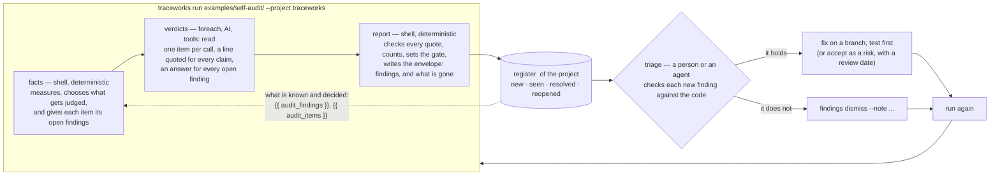

# The self-audits: Traceworks checks itself

Four workflow packages audit the Traceworks sources with Traceworks. They are examples of what the tool is for
(deterministic steps first, an AI only where a judgement is needed, every claim checked, findings kept across runs),
and they are how this repository is kept in shape. None of them needs anything the tool does not give every
workflow.

| Package | The question | Measured by a tool | Judged by an AI | Register |
|---|---|---|---|---|
| [`security`](security/README.md) | Does an untrusted workflow, model or file get past a guarantee of `docs/security.md`? | the areas where it could: call sites found by resolved type | one verdict per area | `security` |
| [`security-changes`](security-changes/README.md) | The same question, asked only of what changed since a commit and of what is one call away | the changed lines (git), the areas they lie in, and the neighbours by resolved call | one verdict per changed or neighbouring area | `security-changes` |
| [`architecture`](architecture/README.md) | Do the sources keep to `docs/architecture.md`? | package graph, layer rules, direct I/O, size, complexity | fine, split or move, per candidate file | `architecture` |
| [`build`](build/README.md) | Is the build reproducible and are the dependencies in order? | Maven and image facts | nothing | none |

## One shape



- **The tool decides what is looked at.** A fact step measures and picks the items. What it does not list is not
  judged, and it says what it could not measure (`NOT MEASURED: ...`).
- **The AI judges one item per call**, with the item in its prompt and read-only tools to follow a call. It does
  not count, set the gate or write what the register reads.
- **A finding counts only when its evidence holds.** Every finding quotes a line, and the report step looks the
  line up. A finding whose quote is not there is shown as unverified and is not in the register.
- **The register remembers.** It knows a finding of an earlier run by its rule and its subject (an area of the
  code, a file; never a line number), and hands the next run what is open and what a person decided, so a
  dismissed finding does not come back, unless a run states it with a higher severity than it was dismissed on: a
  decision covers the severity it was made on (docs/registers.md, "What a decision covers"). What a tool measured is resolved when a full snapshot no longer holds it.
  What a model judged is resolved only when a run says that it is gone (below, "The register is the memory").
- **The register takes medium and high.** Each audit says what a finding of each severity is, by what a user or
  the record relies on. A new finding a verdict rates low passes the same check and is listed in the report of the
  run, and nowhere else: not in the register, not in `findings.jsonl`, not in the gate. Its item counts as judged.
  An open finding the register holds is answered as before, whatever its severity, and what a tool measured keeps
  its path. The severity is the model's word: a model that rates everything low hides nothing from the report of
  the run, but keeps it out of the register.
- **The loop can end.** `security` and `architecture` list every item they could judge, and `security-changes`
  every item its register knows; the register remembers which of them are settled. The next run judges only what changed, was never judged or has an open finding
  (below, "A run judges what needs a verdict").

`traceworks describe examples/self-audit/<topic>` prints each of these workflows before it runs, and
`--html` draws it as a page.

## A round

```bash
traceworks images build examples/self-audit/security                # once per package, and again when its images/ changed
traceworks run examples/self-audit/security --project traceworks    # the project: this repository, in your word
traceworks findings security list                                   # new, seen, resolved, reopened
traceworks findings security show <id>                              # one finding with its detail: the issue, the fix, the quoted line
traceworks findings security dismiss <id> --note "..."              # it does not hold, and why
traceworks findings security accept <id> --note "..."               # it holds and stays: a risk that is carried, with a review date
traceworks run examples/self-audit/security --project traceworks    # again: what was fixed in between is resolved
traceworks diff <first run> <second run>                            # what else changed between the rounds
```

**The project.** A register is kept per audit and per project, so every run of an audit names the project it works
on: here `--project traceworks`, since these audits run on the repository they lie in. The key is your word, and
the same package run with another key on another checkout keeps a register of its own, with its own findings and
decisions (docs/registers.md, "The project of a run"). A run without a project is refused before it starts. The
`findings` commands need no `--project` while a key has one project. To leave the option out of every run, bind
the key to the checkout once, in `traceworks.json` of the home: `"projects": {"traceworks": "/path/to/the/checkout"}`.
A run in that folder is then of that project, and a run there with another key is refused. A `findings` command
without `--project` then means the project of the folder it is run in: in the folder of a declared project that
has no register of the key it is refused and names the projects the key has, so run it in the checkout or name
the project.

Every report step writes its findings twice: as a Markdown report for a reader, and as data (`findings.jsonl`, one
JSON object per finding) for `findings <topic> show` and for scripts. Both are in the record of the run; the register
keeps neither the issue nor the fix, which are a model's words.

Triage is the step that is nobody's workflow: someone checks each new finding against the code before it is
accepted or dismissed, by reproducing it where that is possible. A security finding gets a probe (a package or a
copied run that shows the gap).

When an agent does the triage, it says so. An agent that works with your user is your user to the machine, and
its decision would read as yours. It names itself with `--agent`, or its harness sets `TRACEWORKS_AGENT` once:

```bash
traceworks findings security dismiss <id> --note "RunPaths refuses this mount before the call" --agent claude-code
export TRACEWORKS_AGENT=claude-code     # or once, in the environment the agent's commands run in
```

The register then records the decision as made `by <you> through the agent claude-code`, in its log, in `show`,
`list` and `report.html`, and in the files the next run gets. The name is what the agent says, unsigned: an agent
that leaves it out is recorded as you ([docs/registers.md](../../docs/registers.md), "Who decided").

A finding that holds and gets fixed needs no decision: it stays open, and the next run resolves it: a measured one
because the snapshot no longer states it, a judged one because the run was asked about it and answered "gone". A round ends
when the register shows the fixed findings as resolved. How many findings triage refuted is the
measure of the audit itself: when the share is high, the prompt or the fact step is what gets fixed next. On
2026-11-11 the security verdicts could not read beyond their area, and 8 of 13 findings checked by hand were wrong;
with `tools: read`, on 2026-11-12, all 10 held.

## The register is the memory

A model does not remember, and it does not report the same things twice in the same words. In the second round of
these audits, findings vanished from the registers that nobody had fixed: the model had not named them again, and a
full snapshot that does not state a finding resolved it. So the register tells two kinds of rules apart
(`"judged": true` in a package's `catalog.json`; [docs/registers.md](../../docs/registers.md), "Reconciliation"):

- **A measured finding** (a layer violation, a package cycle, direct I/O where it is forbidden) is resolved at once
  when the snapshot no longer states it. The tool looked, and it is not there.
- **A judged finding** (a security finding, a split or move verdict) stays
  open until a run says explicitly that it is gone. Silence says nothing.

For that, each run asks. The fact step gets what the register knows (`{{ audit_findings }}`, or in `security` and
`security-changes` the file `findings.jsonl` of the register folder, which cuts nothing), reads the rows, and writes into each item of the
loop the open findings that belong to it (and the ones a person decided), so a prompt holds only its own. The
verdict has to answer for each open finding: **it still holds**, with the line as it is now, or **it is gone**,
with a reason. The report step treats "holds" like a new finding (the quote is checked, then the finding is stated
again, under the identity the register knows) and writes "gone" into the envelope's `gone` list. A finding without a
usable answer is neither: the report lists it, the gate does not go green, and the register keeps it open and counts
the silent report (`findings <topic> show <id>` prints the count). "Gone" is not taken from an answer that also
held a finding that did not verify: the item is not judged then, and were the finding resolved, the register would
call the item decided by its earlier verdict and no run would ask again.

Two things keep a person from findings that cost time for nothing, both in `security` and `security-changes`
([security/README.md](security/README.md), "What the judge is told" and "How a finding leaves the register"):

- **The judge knows the stated limits.** A behaviour the documents state as not protected is no finding; code that
  does more than the limit says is one, and in doubt it is a finding with the limit quoted. A model that calls a known finding covered by a limit closes only a low one; a medium or high one stays open, with the limit as its note, for a person. The limits are a file
  of the package, pinned to `docs/security.md` by a test.
- **A finding whose code is gone is named gone by measurement.** When no source file has the path of its subject
  any more, or no area of its file has any of its members, the fact step names it gone without asking a model, and the
  report counts it with its reason. A finding whose members an area of its file still has is asked about there; a member renamed alone is an area of the same run, so a
  defect that is still there is reported under its new name.

| Status in the register | Asked about in the next run? | Leaves that status when |
|---|---|---|
| `OPEN`, `AWAITING_VERIFICATION` | yes | a run answers "gone" (resolved), or a person decides |
| `ACCEPTED_RISK` | no: it is decided, and the prompt says so | its review date passes (then it is asked about again), a run states it with a higher severity than it was accepted on (then it is open), or a person reopens it |
| `DISMISSED` | no | a run states it with a higher severity than it was dismissed on (then it is open), or a person reopens it |

What needs no model is not asked of one: when the member, the file or the quoted line a finding was about is no
longer there, the fact step names the finding as gone itself. An open finding whose item
exists but is not judged in a run (a cap cut it, or its call failed) is not asked about and stays open.

## A run judges what needs a verdict

A page to step through, with a drawing of the loop:
[docs/audit-loop.html](https://flsest.github.io/traceworks/audit-loop.html). The link leads to the page as a
browser shows it; the file loads nothing from the network.

Findings alone cannot say "nothing was found here". An audit that only knows findings asks about every item in
every run, and a model that is asked for a defect finds one: in two rounds of an earlier self-audit of the tests,
51 findings were answered as gone and 52 new ones came, in the same 30 classes. So the audits treat what they judge as
**items** ([docs/registers.md](../../docs/registers.md), "Items"): an area of the code, a candidate file. The fact
step gives each item a digest of what a verdict about it sees, the envelope lists every item with its digest and whether this run
judged it, and the register keeps the digest and the run of each item's last verdict. The next run gets that back
as `{{ audit_items }}`, and its fact step compares:

| The item is | The run |
|---|---|
| `clean` (judged, nothing found) or `decided` (every finding accepted, dismissed or resolved), with the same digest | leaves it out |
| never judged, or changed since its verdict | judges it |
| `open`, with the same digest | asks about its findings again, in the places that are left under the cap |

```bash
traceworks findings                 # per register (key and project): items 87 of 110 settled: 71 clean, 16 decided; 20 open, 3 not judged
traceworks findings security items  # each area with its state and the digest of its last verdict
```

The number has a goal: every item settled. An item comes back when it changes, so a fix is asked about in the next
run, and when the question changes:

| Package | An item is | Its digest holds, with the version of the question | The version of the question |
|---|---|---|---|
| `security` | an area: `<file>#<first member>` | the rules that picked the area and its code | `--verdict-version` in `workflow.json` |
| `architecture` | a candidate file: its path | what the prompt shows of the file: the code, the reasons, the measured findings, the computed context (without the type counts of the packages) | `--verdict-version` in `workflow.json` |

A digest holds what the fact step hands the verdict, not everything a model with `tools: read` may open: an area of
`security` is not judged again because code changed that the area only calls. Raise the
version of the question to have everything judged again.

**The gate follows the items.** The number of findings cannot reach a goal: it grows with attention. The number of
settled items can. So the report step of each audit says in what state every item is after the run, from what the
fact step read of the register and what the run judged, and the gate follows that:

| Gate | When |
|---|---|
| RED | an open finding of high severity stands: a new one, or an open high one of the register that the run did not answer as gone, also when its item got no place or its call failed. `architecture` is RED for a measured rule violation too |
| YELLOW | an item is open (a new finding of medium or high, an open finding that holds or got no answer) or not judged (no place under the cap, a failed call, an answer with a finding that did not verify); or a tool measured a finding, or could not measure something: each package says what |
| GREEN | every item is settled: clean or decided |

A run that finds nothing while items wait is not green. Nor is one while the register holds an open finding that
no item carries: a subject that is still there but is no item any more, or one the register shows cut. No run
asks about such a finding and none names it as gone, so the report lists it under a heading of its own for a person
to decide, and the gate is YELLOW over it, RED when it is high. Every gate description ends with the same words,
`87 of 110 items settled (71 clean, 16 decided; 20 open, 3 not judged)`, and the report of the run has the line
too. It is the report step's count from what the run knows; `traceworks findings` shows the register's own, which
also knows the findings that were resolved long ago, so the two can differ in what is clean and what is decided.
Where nothing sets `{{ audit_items }}` and `{{ audit_findings }}` (a first run), nothing was known
before, and the same holds with what the run judged.

The gate counts what the run states, and the report says where the register will differ:

- **A finding the register holds a decision for, stated again.** A stated finding that passes the evidence check
  counts for the gate and opens its item like any other, whether or not a person accepted or dismissed a finding of
  that rule and subject. What the register shows of a decided finding cannot tell whether this is the same thing:
  in `security` the subject is the area and in `architecture` the file, so a dismissed false positive would
  otherwise hide every later finding of the rule there, and the register keeps one severity and one evidence text
  per finding, which the next report overwrites. So no report compares them. The register knows a finding by rule
  and subject, and what it does when it takes the report depends on the severity (docs/registers.md, "What a
  decision covers"). Stated with a higher severity than the decision was made on, the finding is open again in the
  register: the register and the gate of the run agree, and the next run is asked about it. Stated with the same or
  a lower severity, the register keeps the decision (and with `"decision_on_higher_severity": "keep"` in
  `traceworks.json`, always, which a run does not see). The block a run gets names the severity a decision was made
  on where the row shows another one (`| Decided on: LOW, not on CRITICAL`), so the report of the run lists every
  such finding under "Findings the register holds a decision for", with the status and with what the register does
  by default (`decided on MEDIUM, stated as HIGH, which is above it: the register opens the finding again`, or
  `... not above it: the register keeps the decision`), and says that the gate counts them in this run. What a
  model judged is in an envelope once per rule and subject: `security` states the highest severity of an area's findings of a
  rule, and `architecture` gives one verdict of a kind per file. A person then looks at the register (`findings <topic> show <id>` prints the severity
  and the evidence the decision was made on) and reopens the finding (`findings <topic> reopen <id>`) or sees that
  it is the one that was decided. The cost where the register keeps the decision: a run that reports the finding
  again shows its item open, and the gate not GREEN, for that run. The register calls the item decided and judged,
  so the next run leaves it out, unless the item changed.
- **What the run cannot know.** An accepted risk comes up for review when its date passes, and the register sets it
  to `AWAITING_VERIFICATION` when it applies the next report. The block a run gets shows no review date, so the
  report of that run still counts an item it left out as decided; the next run is asked about the finding.
- **A known finding restated.** In `security`, a finding of the rule and the area of an open finding is that
  finding, also when the answer states it under `findings` and gives no entry under `known`: it is stated with the
  severity the answer gives, and is not counted as one without an answer.
- **A block of findings the register cut.** `{{ audit_findings }}` holds at most 250 rows or 60 000 bytes, the
  decided rows first, and ends with `(+N more: ...)` when it left rows out. Open findings can be among them: their
  item is asked without them, and a verdict that finds nothing would make it read clean. Nothing is lost in the
  register, which keeps a judged finding open until a run names it as gone, but the report would say more than it
  knows. So each fact step records the number (`knownMissing`), and the report step concludes
  nothing from a row that is not there: the gate is not GREEN, the description says `N findings of the register not
  shown to this run`. The block's last line says how many of the missing rows are open (`OPEN 3`), not whose they
  are. So while any open row is missing (`knownMissingOpen`), an item the register calls open
  stays open in the report, whatever was shown of it and whatever was answered; when only decided rows are missing,
  every open finding was shown and the items settle as they would. A finding is still named as gone only by a row
  that was there. Decide or fix findings until the block holds all.

An item name is there once: a second area of one member gets a number (`...~2`). A name over the register's 300
characters is cut and ends with a digest of the whole, in every package. The register takes at most 1000 items in a report. A longer list
is sent in part, the items of the run first, and without `expectedItems`: the register then keeps every item it
knows, and the report says so.

**One failed call is one item not judged.** A call that timed out or answered without JSON no longer makes the
report a partial snapshot that the register rejects: the envelope lists the item with `judged: false`, the register
takes the verdicts of the other items, and the item keeps what the register knew of it. On 2026-11-13 one failed
call of 116 had thrown a security run of two hours away.

## The short check beside the long audit

`security` judges every area of the sources, and a first run of it takes about 110 calls. After that its register
keeps it short: a run judges what changed, by the digest of each area. It still looks at the whole project every
time, and it sees a change only where the changed lines lie in an area.

[`security-changes`](security-changes/README.md) is the check for the time between two long audits, after a day's
work or before a merge. It compares the files of the workspace with a base commit (`--input since=<commit|tag|date>`, or
without the input the commit of the last run of the check). The tool that compiles the files decides what changed,
from content: git hands it the trees and the blobs it asks for by id and never sees a path of the workspace, since
a workspace can make git's diff say less. It maps the changed lines to the areas the same finder produces, and adds the
areas one call away from a changed member, in both directions and through an interface to every implementation:
a helper that no rule points at brings in the areas that call it. The model judges only those, each with the
changed code it is connected with in its prompt. Without a base the run refuses, and so it does for a base that is the workspace commit itself or
that would leave commits after the last run unjudged (`skip=yes` goes on knowingly, and the gate is not GREEN
then).

```bash
traceworks run examples/self-audit/security-changes --project traceworks --input since=v0.1.0
traceworks run examples/self-audit/security-changes --project traceworks   # since the workspace commit of the last run of this check
```

Its gate speaks about the changes only, and its report says how many areas of the project it did not look at. A
changed file it cannot judge (a script, a workflow, a build file, Java code outside the source roots) is named and
keeps the gate from its best word, YELLOW ("nothing found in what changed"); it never says GREEN, which is the full
audit's word alone; tests and documentation are counted. A changed import or class head
picks every area of its file and makes the areas that call into it neighbours, the digest of an area holds what
its calls resolve to, and the base moves only when the run judged everything a run can judge. It
has a register of its own, `security-changes`, whose items are the areas the check ever picked. An open finding
there is asked about in every run until an answer says it is gone or a person decides, whatever the base of the
run, and an area whose call failed is judged by the next run: the register holds nothing that no run comes back
to. It does not replace the long audit: a change two calls away, a changed constant and code that was never
audited before the base are outside it ([security-changes/README.md](security-changes/README.md), "What it does
not see").

## Cost

The steps before and after the AI cost seconds. The verdict steps make one call per item, one after the other:
about 110 for a first run of `security` and 20 for `architecture` on these sources; `security-changes` calls once
per changed or neighbouring area, and once per area with an open finding. A later run calls only for the items that
changed or are open.

Which model judges: `security` opens a model choice, `judge`, and a run picks one of its options with
`--input judge=fable` (the default, `claude-fable-5-2` through Claude), `judge=opus` (`claude-opus-5-5` through
Claude) or `judge=astra` (`openai/gpt-6-astra` through Pi); a run needs the image and the credential of the provider
it picked only. All three feed the register `security` of the run's project, where a finding is the same finding whoever reported it, and
a verdict of one judge settles an item for the next ([security/README.md](security/README.md), "The model that
judges"). `security-changes` opens the same choice, and `architecture` judges with
`claude-opus-5-5`, named in its `workflow.json`.

## Tests

The tools the packages build into their images, and the scripts they run, are tested in the Maven modules
`tests`, `tests-architecture` and `tests-build` next to the packages, without a container and without an AI.
